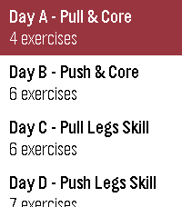

<!-- Generated by scripts/update_app_directory.py: do not edit by hand -->
[← All Pebble Developers](../developers.md)

# Andrew Whaley

*1 app · Last updated 2026-10-12 · [About these lists](../about-app-lists.md)*

Links: [Pebble App Store](https://apps.repebble.com/apps/dev/andrew-whaley_768abc6975453cf041d07667) · [GitHub (azw413)](https://github.com/azw413) · [Website (pebblestrength.app)](https://pebblestrength.app)

<h2 class="app-name" id="app-4354ca8ffa6949d2997de703"><a href="https://apps.repebble.com/4354ca8ffa6949d2997de703">Strength</a> v1.1.1</h2>
<a class="app-source" href="https://github.com/azw413/pebble-strength" title="Source code" data-search-exclude>View source</a>

App · <a href="https://forum.rebble.io/t/1180" title="Discuss this app on the Rebble forum" data-search-exclude>Forum thread</a>

Apache-2.0 Released 2026-07-22 Updated 2026-07-27

Runs on: Round 2, Time 2, Pebble 2 Duo, Pebble 2, Time Round, Time

Program strength workouts on the web and run them from your Pebble - guided sets, timed holds, and rest countdowns, fully usable mid-set. Your sets sync back to pebblestrength.app for volume…

