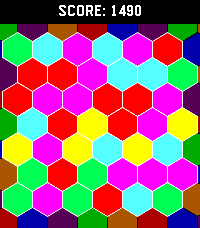
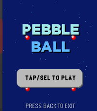
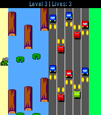

<!-- Generated by scripts/update_app_directory.py: do not edit by hand -->
[← All Pebble Developers](../developers.md)

# Andrew129260

*1 watchface and 3 apps · Last updated 2026-10-12 · [About these lists](../about-app-lists.md)*

Links: [Pebble App Store](https://apps.repebble.com/apps/dev/andrew129260_d443835b77205f3b7e2f01c9) · [GitHub (Andrew129260)](https://github.com/Andrew129260)

<button type="button" data-filter="all" aria-pressed="true">All 4</button><button type="button" data-filter="watchface" aria-pressed="false">Watchfaces 1</button><button type="button" data-filter="watchapp" aria-pressed="false">Apps 3</button>

<label class="dev-sort">Sort by <select><option value="updated">Recently updated</option><option value="released">Newest release</option><option value="title">A–Z</option></select></label>

<h2 class="app-name" id="app-b08db659baf2425c85bcc5aa"><a href="https://apps.repebble.com/b08db659baf2425c85bcc5aa">Pexic</a> v3.2</h2>
<a class="app-source" href="https://github.com/Andrew129260/PeXic" title="Source code" data-search-exclude>View source</a>

App

GPL-3.0 Released 2026-06-09 Updated 2026-10-11

Runs on: Round 2, Time 2

Hexic but for pebble! It&#x27;s the classic you know and love, optimized for Pebble Time 2 (emery) and Pebble Round 2 (gabbro)

<h2 class="app-name" id="app-7a641809d43a4acf813fdea5"><a href="https://apps.repebble.com/7a641809d43a4acf813fdea5">PebbleBall</a> v2.2</h2>
<a class="app-source" href="https://github.com/Andrew129260/PebbleBall" title="Source code" data-search-exclude>View source</a>

App

GPL-3.0 Released 2026-06-10 Updated 2026-10-11

Runs on: Time 2

This is a Jezzball clone for the pebble time 2! The classic windows game on your wrist! With touch support! Your goal is to trap all the balls in the smallest boxes that you can. Give it a try!

<h2 class="app-name" id="app-21268740bc164e18907f66b8"><a href="https://apps.repebble.com/21268740bc164e18907f66b8">Froggle</a> v6.2.2</h2>
<a class="app-source" href="https://github.com/Andrew129260/Froggle" title="Source code" data-search-exclude>View source</a>

App

GPL-3.0 Released 2026-06-05 Updated 2026-10-11

Runs on: Round 2, Time 2, Pebble 2 Duo, Pebble 2, Time, Classic

Frogger, but for Pebble! Multiple challenging levels, which get faster as it goes... Can you dodge the cars and hop those logs? You get an extra life for each level you complete.. Good luck!…

<h2 class="app-name" id="app-bc78f7a29a094b3fad53cc22"><a href="https://apps.repebble.com/bc78f7a29a094b3fad53cc22">Timely 2</a> v6.0.0</h2>
<a class="app-source" href="https://github.com/Andrew129260/Timely-2" title="Source code" data-search-exclude>View source</a>

Watchface

GPL-3.0 Released 2026-06-01 Updated 2026-09-20

Runs on: Time 2, Pebble 2 Duo, Pebble 2, Time, Classic

I have kept the original spirit of the original with a few twists. 1.) I have added the ability to sync the phone battery life as a option. If you disable the feature, it will show the classic…

