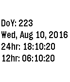
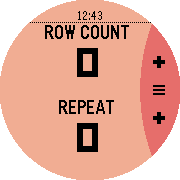

<!-- Generated by scripts/update_app_directory.py: do not edit by hand -->
[← All Pebble Developers](../developers.md)

# Android Hell

*2 apps · Last updated 2026-10-12 · [About these lists](../about-app-lists.md)*

Links: [Pebble App Store](https://apps.repebble.com/apps/dev/android-hell_55e113295895cba1300000c0) · [GitHub (AndroidHell)](https://github.com/AndroidHell)

<button type="button" data-filter="all" aria-pressed="true">All 2</button><button type="button" data-filter="watchface" aria-pressed="false" disabled>Watchfaces 0</button><button type="button" data-filter="watchapp" aria-pressed="false">Apps 2</button>

<label class="dev-sort">Sort by <select><option value="updated">Recently updated</option><option value="released">Newest release</option><option value="title">A–Z</option></select></label>

<h2 class="app-name" id="app-57755f15ba2fe5a0c10005d9"><a href="https://apps.repebble.com/57755f15ba2fe5a0c10005d9">Day of Year</a> v1.1</h2>
<a class="app-source" href="https://github.com/AndroidHell/DayOfYear" title="Source code" data-search-exclude>View source</a>

App

No licence Released 2016-06-30 Updated 2016-08-10

Runs on: Round 2, Time 2, Pebble 2 Duo, Pebble 2, Time Round, Time, Classic

**Update: I redid everything so there is a lot less code and the time actually updates now. ** This is a simple watch app used to show you the day of year. It was initially intended to help me…

<h2 class="app-name" id="app-571198f9c96f2ef8fc000007"><a href="https://apps.repebble.com/571198f9c96f2ef8fc000007">Knibble In The Round</a> v1.2</h2>
<a class="app-source" href="https://github.com/AndroidHell/KnibbleInTheRound" title="Source code" data-search-exclude>View source</a>

App

No licence Released 2016-04-16 Updated 2016-04-22

Runs on: Round 2, Time Round

DISCLAIMER: This is a fork of Knibble by Indika Informatics with PTR compatability. Knibble In The Round is a simple stitch counter for knitters. It keeps track of rows and repeats and can also be…

