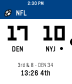

<!-- Generated by scripts/update_app_directory.py: do not edit by hand -->
[← All Pebble Developers](../developers.md)

# Andy Burris

*1 app · Last updated 2026-10-11 · [About these lists](../about-app-lists.md)*

Links: [Pebble App Store](https://apps.repebble.com/apps/dev/andy-burris_5b71f6bb23eade0001c9f627) · [GitHub (andyburris)](https://github.com/andyburris)

<h2 class="app-name" id="app-637af4ebc6c24a000a815ecb"><a href="https://apps.repebble.com/637af4ebc6c24a000a815ecb">Sports</a> v0.3</h2>
<a class="app-source" href="https://github.com/andyburris/pebble-sports" title="Source code" data-search-exclude>View source</a>

App

No licence Released 2022-11-21 Updated 2025-09-02

Runs on: Round 2, Time 2, Pebble 2 Duo, Pebble 2, Time Round, Time, Classic

A native sports app for Pebble-- get your favorite NFL, MLB, NHL, and NBA scores live on your wrist

