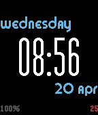
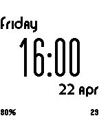

<!-- Generated by scripts/update_app_directory.py: do not edit by hand -->
[← All Pebble Developers](../developers.md)

# Andy McDade

*2 watchfaces · Last updated 2026-10-11 · [About these lists](../about-app-lists.md)*

Links: [Pebble App Store](https://apps.repebble.com/apps/dev/andy-mcdade_52fe01639afd98fbae00015a) · [GitHub (redlegoman)](https://github.com/redlegoman)

<button type="button" data-filter="all" aria-pressed="true">All 2</button><button type="button" data-filter="watchface" aria-pressed="false">Watchfaces 2</button><button type="button" data-filter="watchapp" aria-pressed="false" disabled>Apps 0</button>

<label class="dev-sort">Sort by <select><option value="updated">Recently updated</option><option value="released">Newest release</option><option value="title">A–Z</option></select></label>

<h2 class="app-name" id="app-57172b59c88396d123000002"><a href="https://apps.repebble.com/57172b59c88396d123000002">RLM Simple Colour Watch</a> v1.111</h2>
<a class="app-source" href="https://github.com/redlegoman/Colour-RLM-Simple-Watch-w-Config" title="Source code" data-search-exclude>View source</a>

Watchface

Released 2016-04-20 Updated 2025-11-26

Runs on: Time 2, Time

A simple digital watch face with a nice big font, a battery percentage and seconds ticking away in the corner. Everything I need with a little splash of colour. You can now choose the colours for…

<h2 class="app-name" id="app-541eb5e46cd005ba4b000108"><a href="https://apps.repebble.com/541eb5e46cd005ba4b000108">RLM Simple Watch</a> v1.101</h2>
<a class="app-source" href="https://github.com/redlegoman/RLM-SIMPLE-WATCH" title="Source code" data-search-exclude>View source</a>

Watchface

Released 2014-09-21 Updated 2016-04-22

Runs on: Time 2, Pebble 2 Duo, Pebble 2, Time, Classic

Simple watch face, nothing fancy. Nice big time, with the day and date at jaunty alignments. Also has the battery percentage (should I put it on charge tonight?) and the seconds ticking away in…

