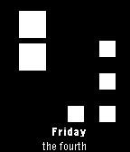

<!-- Generated by scripts/update_app_directory.py: do not edit by hand -->
[← All Pebble Developers](../developers.md)

# Andyco

*1 watchface · Last updated 2026-10-12 · [About these lists](../about-app-lists.md)*

Links: [Pebble App Store](https://apps.repebble.com/apps/dev/andyco_53b4453a03e5c08be5000031) · [GitHub (MadAnthonyWayne)](https://github.com/MadAnthonyWayne)

<h2 class="app-name" id="app-53b6e9bcfaf88bed2700002a"><a href="https://apps.repebble.com/53b6e9bcfaf88bed2700002a">Binary Blocks</a> v2.0.0</h2>
<a class="app-source" href="https://github.com/MadAnthonyWayne/BinaryBlocks2" title="Source code" data-search-exclude>View source</a>

Watchface

No licence Released 2014-07-04 Updated 2014-07-04

Runs on: Time 2, Pebble 2 Duo, Pebble 2, Time, Classic

It displays the time in binary, using squares to represent the hour/minutes. The left most column is the hour, the next column is the tens digit of minutes, and the rightmost column is the ones…

