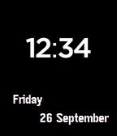

<!-- Generated by scripts/update_app_directory.py: do not edit by hand -->
[← All Pebble Developers](../developers.md)

# aniri

*1 watchface · Last updated 2026-10-12 · [About these lists](../about-app-lists.md)*

Links: [Pebble App Store](https://apps.repebble.com/apps/dev/aniri_531a2eec4969a21eb50005a3) · [GitHub (aniri)](https://github.com/aniri)

<h2 class="app-name" id="app-54254df335528a42410000b5"><a href="https://apps.repebble.com/54254df335528a42410000b5">Invert Face</a> v1.1</h2>
<a class="app-source" href="https://github.com/aniri/pebble-inversewatchface" title="Source code" data-search-exclude>View source</a>

Watchface

No licence Released 2014-09-26 Updated 2014-09-30

Runs on: Time 2, Pebble 2 Duo, Pebble 2, Time, Classic

Shows time, day of the week and date. The colors get inverted when the watch is connected/disconnected from the phone.

