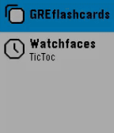

<!-- Generated by scripts/update_app_directory.py: do not edit by hand -->
[← All Pebble Developers](../developers.md)

# ankithreddy

*1 app · Last updated 2026-10-11 · [About these lists](../about-app-lists.md)*

Links: [Rebble App Store](https://apps.rebble.io/en_US/developer/6127897b8cd7fb00554d39f5/1) · [GitHub (ankithreddypati)](https://github.com/ankithreddypati) · [Website (ankithreddy.me)](https://ankithreddy.me/)

<h2 class="app-name" id="app-65a3d950e46ef105779235d4"><a href="https://apps.rebble.io/en_US/application/65a3d950e46ef105779235d4">GRE Flashcards</a> v1.1</h2>
<a class="app-source" href="https://github.com/ankithreddypati/GREFlashcards" title="Source code" data-search-exclude>View source</a>

App

MIT Released 2024-01-14 Updated 2024-01-14 Rebble App Store

Runs on: Round 2, Time 2, Pebble 2 Duo, Pebble 2, Time Round, Time, Classic

GRE Flashcards is a learning app designed for Pebble smartwatches for GRE examination. It provides an interactive and convenient way for users to enhance their vocabulary skills on the go. The app…

