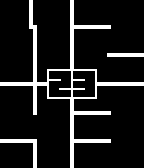

<!-- Generated by scripts/update_app_directory.py: do not edit by hand -->
[← All Pebble Developers](../developers.md)

# antgiant

*1 watchface · Last updated 2026-10-11 · [About these lists](../about-app-lists.md)*

Links: [Pebble App Store](https://apps.repebble.com/apps/dev/antgiant_52f58a5736a500c6cf000223) · [GitHub (antgiant)](https://github.com/antgiant)

<h2 class="app-name" id="app-57be4d805e3c3d0bfc000021"><a href="https://apps.repebble.com/57be4d805e3c3d0bfc000021">Lines (Enhanced)</a> v4.4</h2>
<a class="app-source" href="https://github.com/antgiant/pebble-LinesWatch" title="Source code" data-search-exclude>View source</a>

Watchface

No licence Released 2016-08-25 Updated 2016-11-15

Runs on: Round 2, Time 2, Pebble 2 Duo, Pebble 2, Time Round, Time, Classic

Lines (Enhanced) is a minimalist digital watch face with beautifully animated transitions. Once you see the numbers you will always be able to read it at a glance. This watch face is fully…

