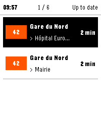

<!-- Generated by scripts/update_app_directory.py: do not edit by hand -->
[← All Pebble Developers](../developers.md)

# Anthodev

*1 app · Last updated 2026-10-12 · [About these lists](../about-app-lists.md)*

Links: [Pebble App Store](https://apps.repebble.com/apps/dev/anthodev_80b2b96681175b0fd3ddfe88) · [GitHub (Anthodev)](https://github.com/Anthodev)

<h2 class="app-name" id="app-6d6aa01b7ecb4cfea469a183"><a href="https://apps.repebble.com/6d6aa01b7ecb4cfea469a183">Lapin Futé</a> v1.2.4</h2>
<a class="app-source" href="https://github.com/Anthodev/lapin-fute" title="Source code" data-search-exclude>View source</a>

App

MIT Released 2026-09-13 Updated 2026-10-07

Runs on: Round 2, Time 2

Lapin Futé brings the next Île-de-France public transport arrivals to your Pebble. Save up to six favorite journeys across Métro, RER, Transilien, tram and bus services. Choose your departure…

