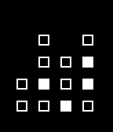

<!-- Generated by scripts/update_app_directory.py: do not edit by hand -->
[← All Pebble Developers](../developers.md)

# Anthony Avina

*1 watchface · Last updated 2026-10-11 · [About these lists](../about-app-lists.md)*

Links: [Pebble App Store](https://apps.repebble.com/apps/dev/anthony-avina_542b9ae11ee2a0aa6500010b) · [GitHub (aavina)](https://github.com/aavina) · [Website (en.wikipedia.org)](http://en.wikipedia.org/wiki/Binary_clock)

<h2 class="app-name" id="app-5485605c075d4cc545000051"><a href="https://apps.repebble.com/5485605c075d4cc545000051">BinFace</a> v1.1</h2>
<a class="app-source" href="https://github.com/aavina/binface" title="Source code" data-search-exclude>View source</a>

Watchface

No licence Released 2014-12-08 Updated 2015-01-03

Runs on: Time 2, Pebble 2 Duo, Pebble 2, Time, Classic

A simple, binary watchface for Pebble. Displays hours and minutes in columns of bits in the format: &quot;HH:MM&quot; Supports both 24-hour and 12-hour format based on user&#x27;s Time Display configuration…

