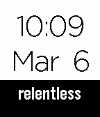

<!-- Generated by scripts/update_app_directory.py: do not edit by hand -->
[← All Pebble Developers](../developers.md)

# Anthony Seo

*1 watchface · Last updated 2026-10-12 · [About these lists](../about-app-lists.md)*

Links: [Pebble App Store](https://apps.repebble.com/apps/dev/anthony-seo_5478b602f9437860120000c1) · [GitHub (anthonyseo)](https://github.com/anthonyseo) · [Website (anthonyseo.com)](http://www.anthonyseo.com/relentless)

<h2 class="app-name" id="app-554c46565fa04f617500011b"><a href="https://apps.repebble.com/554c46565fa04f617500011b">Relentless</a> v1.0</h2>
<a class="app-source" href="https://github.com/anthonyseo/relentless" title="Source code" data-search-exclude>View source</a>

Watchface

No licence Released 2015-05-08 Updated 2015-05-08

Runs on: Time 2, Pebble 2 Duo, Pebble 2, Time, Classic

A simple watch face with a powerful reminder to be &quot;relentless.&quot;

