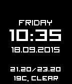

<!-- Generated by scripts/update_app_directory.py: do not edit by hand -->
[← All Pebble Developers](../developers.md)

# Anton Isaiev

*1 watchface · Last updated 2026-10-11 · [About these lists](../about-app-lists.md)*

Links: [Pebble App Store](https://apps.repebble.com/apps/dev/anton-isaiev_547ab7343fd3889309000171) · [GitHub (detores)](https://github.com/detores)

<h2 class="app-name" id="app-55fbc0c63c882806bf00003d"><a href="https://apps.repebble.com/55fbc0c63c882806bf00003d">Simple Watch</a> v1.3</h2>
<a class="app-source" href="https://github.com/detores/Pebble-SimpleWatch" title="Source code" data-search-exclude>View source</a>

Watchface

Released 2015-09-18 Updated 2016-11-13

Runs on: Time 2, Pebble 2 Duo, Pebble 2, Time, Classic

Simple watchface with weather based on your location and exchage rates USD/UAH.

