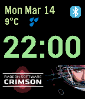
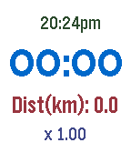
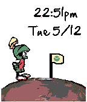
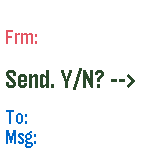
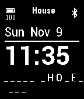
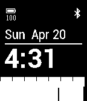
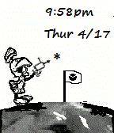

<!-- Generated by scripts/update_app_directory.py: do not edit by hand -->
[← All Pebble Developers](../developers.md)

# Antonio Asaro

*6 watchfaces and 3 apps · Last updated 2026-10-12 · [About these lists](../about-app-lists.md)*

Links: [Pebble App Store](https://apps.repebble.com/apps/dev/antonio-asaro_52cd5e150799b0643b00003c) · [Rebble App Store](https://apps.rebble.io/en_US/developer/52cd5e150799b0643b00003c/1) · [GitHub (antonioasaro)](https://github.com/antonioasaro)

<button type="button" data-filter="all" aria-pressed="true">All 9</button><button type="button" data-filter="watchface" aria-pressed="false">Watchfaces 6</button><button type="button" data-filter="watchapp" aria-pressed="false">Apps 3</button>

<label class="dev-sort">Sort by <select><option value="updated">Recently updated</option><option value="released">Newest release</option><option value="title">A–Z</option></select></label>

<h2 class="app-name" id="app-55995cf6e47bb3dce400004e"><a href="https://apps.repebble.com/55995cf6e47bb3dce400004e">AMD Watchface</a> v1.91</h2>
<a class="app-source" href="https://github.com/antonioasaro/Antonio-AMD" title="Source code" data-search-exclude>View source</a>

Watchface

No licence Released 2015-07-05 Updated 2016-12-09

Runs on: Time 2, Pebble 2 Duo, Pebble 2, Time, Classic

Simple animated AMD watchface (every min). With BT connectivity alerts. FYI - trying to emulate this: https://www.youtube.com/watch?v=c2QKdtU2YvE

<h2 class="app-name" id="app-5479daef572d57ad9100002b"><a href="https://apps.repebble.com/5479daef572d57ad9100002b">Jogger</a> v1.73</h2>
<a class="app-source" href="https://github.com/antonioasaro/Antonio-Jogger" title="Source code" data-search-exclude>View source</a>

App

No licence Released 2014-11-29 Updated 2016-03-06

Runs on: Round 2, Time 2, Pebble 2 Duo, Pebble 2, Time Round, Time, Classic

Very very simple jogging aid. For 10+1 runs. Vibrates after 10mins (== walk break) and then one minute later (== resume running). Buttons: top=start, bottom=stop; middle (long press)=reset. Press…

<h2 class="app-name" id="app-52ed9dc7a8030fa828000006"><a href="https://apps.repebble.com/52ed9dc7a8030fa828000006">Hangout</a> v2.2</h2>
<a class="app-source" href="https://github.com/antonioasaro/Antonio-Hangout_2.0.git" title="Source code" data-search-exclude>View source</a>

Watchface

No licence Released 2014-02-02 Updated 2016-02-27

Runs on: Round 2, Time 2, Pebble 2 Duo, Pebble 2, Time Round, Time, Classic

Simple watchface with date, time, battery level, bluetooth status AND hangman puzzle. Every min, a random letter is exposed. Try to guess the word before it&#x27;s fully visible. Word lengths range…

<h2 class="app-name" id="app-55a964ac0dc1ced6c40000e3"><a href="https://apps.repebble.com/55a964ac0dc1ced6c40000e3">EveningNews</a> v2.1</h2>
<a class="app-source" href="https://github.com/antonioasaro/Antonio-EveningNews/tree/master/src" title="Source code" data-search-exclude>View source</a>

App

No licence Released 2015-07-17 Updated 2016-02-27

Runs on: Round 2, Time 2, Pebble 2 Duo, Pebble 2, Time Round, Time, Classic

Top 5 google rss headlines posted at ~6:30pm ET &amp; again at ~6:30 PT. Note: sorry guys, only ET &amp; PT timezones for the moment. To do more, I&#x27;d have to track per-user TZ in a database on the server…

<h2 class="app-name" id="app-5552c1411ba177287d0000b2"><a href="https://apps.repebble.com/5552c1411ba177287d0000b2">Marvin Colour</a> v1.2</h2>
<a class="app-source" href="https://github.com/antonioasaro/Antonio-Marvin_2.0.colour" title="Source code" data-search-exclude>View source</a>

Watchface

No licence Released 2015-05-13 Updated 2015-12-15

Runs on: Round 2, Time 2, Time Round, Time

Everyone&#x27;s favourite Martian - now in colour. Blasts time/date on the minute

<h2 class="app-name" id="app-52cd665a0799b093a7000042"><a href="https://apps.rebble.io/en_US/application/52cd665a0799b093a7000042">EMAIL to SMS</a> v1.2</h2>
<a class="app-source" href="https://github.com/antonioasaro/Antonio-SMS_2.0.git" title="Source code" data-search-exclude>View source</a>

App

No licence Released 2014-01-08 Updated 2015-12-15 Rebble App Store

Runs on: Round 2, Time 2, Pebble 2 Duo, Pebble 2, Time Round, Time, Classic

SMS directly from the pebble. Configure email-&gt;text addr + canned msgs and then, send texts to your friends. Example of config page ... From: 4165551212 Who0: Lucy Num0: 9055551212@sms.carrier.com…

<h2 class="app-name" id="app-5470aa8232fb2d119700009a"><a href="https://apps.repebble.com/5470aa8232fb2d119700009a">Wheel of Fortuna</a> v1.31</h2>
<a class="app-source" href="https://github.com/antonioasaro/Antonio-Wheel_Of_Fortuna" title="Source code" data-search-exclude>View source</a>

Watchface

No licence Released 2014-11-22 Updated 2014-11-25

Runs on: Time 2, Pebble 2 Duo, Pebble 2, Time, Classic

Random category &amp; words every 5 mins, from everyone&#x27;s favourite show. :) Also, basic time, date, battery status &amp; bluetooth connection (w/ vibration if connection is lost).

<h2 class="app-name" id="app-535d6bda91c4a6472e000061"><a href="https://apps.repebble.com/535d6bda91c4a6472e000061">Activity</a> v1.1</h2>
<a class="app-source" href="https://github.com/antonioasaro/Antonio-Activity_2.0.git" title="Source code" data-search-exclude>View source</a>

Watchface

No licence Released 2014-04-27 Updated 2014-04-27

Runs on: Time 2, Pebble 2 Duo, Pebble 2, Time, Classic

Tracks last hour of activity along with standard battery + phone connection (with vibration) status

<h2 class="app-name" id="app-52cd63ac9505d1780b00005b"><a href="https://apps.repebble.com/52cd63ac9505d1780b00005b">Marvin the Martian</a> v1.1</h2>
<a class="app-source" href="https://github.com/antonioasaro/Antonio-Marvin_2.0.git" title="Source code" data-search-exclude>View source</a>

Watchface

No licence Released 2014-01-08 Updated 2014-02-05

Runs on: Time 2, Pebble 2 Duo, Pebble 2, Time, Classic

Marvin fires his integrator/disintegrator weapon at the date/time

