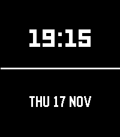
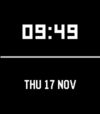

<!-- Generated by scripts/update_app_directory.py: do not edit by hand -->
[← All Pebble Developers](../developers.md)

# Anubhav Gupta

*2 watchfaces · Last updated 2026-10-11 · [About these lists](../about-app-lists.md)*

Links: [Rebble App Store](https://apps.rebble.io/en_US/developer/579c99cf1482cd5d4b00033f/1) · [GitHub (anubhavgupta)](https://github.com/anubhavgupta)

<button type="button" data-filter="all" aria-pressed="true">All 2</button><button type="button" data-filter="watchface" aria-pressed="false">Watchfaces 2</button><button type="button" data-filter="watchapp" aria-pressed="false" disabled>Apps 0</button>

<label class="dev-sort">Sort by <select><option value="updated">Recently updated</option><option value="released">Newest release</option><option value="title">A–Z</option></select></label>

<h2 class="app-name" id="app-58215c5d34da213f22000029"><a href="https://apps.rebble.io/en_US/application/58215c5d34da213f22000029">Big Simple 24</a> v1.1</h2>
<a class="app-source" href="https://github.com/anubhavgupta/pebble-big-simple-watch-face/tree/24-hrs" title="Source code" data-search-exclude>View source</a>

Watchface

No licence Released 2016-11-08 Updated 2016-11-17 Rebble App Store

Runs on: Round 2, Time 2, Pebble 2 Duo, Pebble 2, Time Round, Time

24 Hr mode version of `Big Simple` watch face. Big and simple watch face, shows 24hr time, day, date and month. For 12 Hr version of the same watchface, search for `Big Simple` watchface.

<h2 class="app-name" id="app-581f51449cbbaf2ef20002bb"><a href="https://apps.rebble.io/en_US/application/581f51449cbbaf2ef20002bb">Big Simple</a> v1.2</h2>
<a class="app-source" href="https://github.com/anubhavgupta/pebble-big-simple-watch-face" title="Source code" data-search-exclude>View source</a>

Watchface

No licence Released 2016-11-06 Updated 2016-11-17 Rebble App Store

Runs on: Round 2, Time 2, Pebble 2 Duo, Pebble 2, Time Round, Time

Big and simple watch face, shows 12hr time, day, date and month. For 24 hr version, please search for &#x27;Big Simple 24&#x27;.

