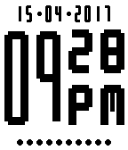
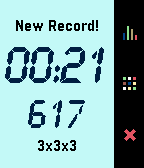

<!-- Generated by scripts/update_app_directory.py: do not edit by hand -->
[← All Pebble Developers](../developers.md)

# aocodermx

*2 watchfaces and 2 apps · Last updated 2026-10-11 · [About these lists](../about-app-lists.md)*

Links: [Rebble App Store](https://apps.rebble.io/en_US/developer/564109d4ae3ac6afa2000084/1) · [GitHub (aocodermx)](https://github.com/aocodermx) · [Website (aocodermx.me)](http://aocodermx.me/projects/SimpleDots/)

<button type="button" data-filter="all" aria-pressed="true">All 4</button><button type="button" data-filter="watchface" aria-pressed="false">Watchfaces 2</button><button type="button" data-filter="watchapp" aria-pressed="false">Apps 2</button>

<label class="dev-sort">Sort by <select><option value="updated">Recently updated</option><option value="released">Newest release</option><option value="title">A–Z</option></select></label>

<h2 class="app-name" id="app-58f2d48e6ca387fc52001098"><a href="https://apps.rebble.io/en_US/application/58f2d48e6ca387fc52001098">SimpleDots</a> v1.2</h2>
<a class="app-source" href="https://github.com/aocodermx/SimpleDots" title="Source code" data-search-exclude>View source</a>

Watchface

GPL-3.0 Released 2017-04-16 Updated 2017-05-01 Rebble App Store

Runs on: Time 2, Pebble 2 Duo, Pebble 2, Time, Classic

Minimalistic watchface to display weather icons, date, time, and the battery dots. A simple buy great way to see the battery level on your watch. Features: * Optional Weather Icon * Optional Date…

<h2 class="app-name" id="app-572c146d68ddfb5a09000006"><a href="https://apps.rebble.io/en_US/application/572c146d68ddfb5a09000006">BigCounter</a> v1.1</h2>
<a class="app-source" href="https://github.com/aocodermx/BigCounter" title="Source code" data-search-exclude>View source</a>

App

GPL-3.0 Released 2016-05-06 Updated 2016-05-21 Rebble App Store

Runs on: Time 2, Pebble 2 Duo, Pebble 2, Time, Classic

Count anything using the whole Pebble screen with BIG NUMBERS. No more small counts, no more small numbers. Features: * Self adjustable BIG NUMBERS. * Select your base, from base 2 up to base 16…

<h2 class="app-name" id="app-56f86ab161a016ff7f00001f"><a href="https://apps.rebble.io/en_US/application/56f86ab161a016ff7f00001f">Time &amp; Quotes</a> v1.2</h2>
<a class="app-source" href="https://github.com/aocodermx/TimeAndQuotes" title="Source code" data-search-exclude>View source</a>

Watchface

GPL-3.0 Released 2016-03-27 Updated 2016-05-15 Rebble App Store

Runs on: Time 2, Pebble 2 Duo, Pebble 2, Time, Classic

Display the current time and your FAVORITE QUOTES/PHRASES from the authors you love, right in your watch. Just add your favorite quotes and the watchface will display it in a nice way. The…

<h2 class="app-name" id="app-56410b02500343416c000086"><a href="https://apps.rebble.io/en_US/application/56410b02500343416c000086">RubikStopTap</a> v1.3</h2>
<a class="app-source" href="https://github.com/aocodermx/RubikStopTap" title="Source code" data-search-exclude>View source</a>

App

GPL-3.0 Released 2015-11-09 Updated 2016-01-17 Rebble App Store

Runs on: Round 2, Time 2, Pebble 2 Duo, Pebble 2, Time Round, Time, Classic

The best application to measure your time solving the Magic Cube, just select the size of your cube, Scramble your cube, shake your Pebble to start review time, when Pebble vibes start solving…

