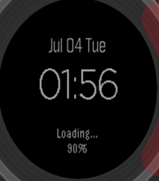

<!-- Generated by scripts/update_app_directory.py: do not edit by hand -->
[← All Pebble Developers](../developers.md)

# aoki

*1 watchface · Last updated 2026-10-12 · [About these lists](../about-app-lists.md)*

Links: [Rebble App Store](https://apps.rebble.io/en_US/developer/5666ed0c3415485e90000044/1) · [GitHub (ringohub)](https://github.com/ringohub)

<h2 class="app-name" id="app-595a7552b67f9f814d00183a"><a href="https://apps.rebble.io/en_US/application/595a7552b67f9f814d00183a">Snazzy</a> v1.0</h2>
<a class="app-source" href="https://github.com/ringohub/pebble-snazzy" title="Source code" data-search-exclude>View source</a>

Watchface

Released 2017-07-03 Updated 2017-07-03 Rebble App Store

Runs on: Round 2, Time 2, Pebble 2 Duo, Pebble 2, Time Round, Time, Classic

Snazzy watch face 👯

