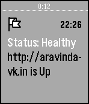

<!-- Generated by scripts/update_app_directory.py: do not edit by hand -->
[← All Pebble Developers](../developers.md)

# Aravinda

*1 app · Last updated 2026-10-12 · [About these lists](../about-app-lists.md)*

Links: [Pebble App Store](https://apps.repebble.com/apps/dev/aravinda_54afbafda1eea12acb000069) · [GitHub (aravindavk)](https://github.com/aravindavk) · [Website (aravindavk.in)](http://aravindavk.in)

<h2 class="app-name" id="app-554627a6ab49e41f8f00004b"><a href="https://apps.repebble.com/554627a6ab49e41f8f00004b">webmon</a> v1.1</h2>
<a class="app-source" href="https://github.com/aravindavk/webmon" title="Source code" data-search-exclude>View source</a>

App

No licence Released 2015-05-03 Updated 2015-05-31

Runs on: Time 2, Time

Pebble Timeline app for Websites Health monitoring. Open APP CONFIG and add URL you want to Track. Thats it. A Cron runs every one hour in App server, sends Timeline notification if that website…

