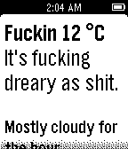

<!-- Generated by scripts/update_app_directory.py: do not edit by hand -->
[← All Pebble Developers](../developers.md)

# ArgyleInk

*1 app · Last updated 2026-10-12 · [About these lists](../about-app-lists.md)*

Links: [Pebble App Store](https://apps.repebble.com/apps/dev/argyleink_52f9b7c5afe055aaff0000b3) · [GitHub (argyleink)](https://github.com/argyleink)

<h2 class="app-name" id="app-53b6e0eb5ad92e9a2600020f"><a href="https://apps.repebble.com/53b6e0eb5ad92e9a2600020f">MF&#x27;n Weather</a> v2.0</h2>
<a class="app-source" href="https://github.com/argyleink/Colorful-Weather" title="Source code" data-search-exclude>View source</a>

App

MIT Released 2014-07-04 Updated 2015-10-11

Runs on: Time 2, Pebble 2 Duo, Pebble 2, Time, Classic

CAUTION: This app is full of profanity. It&#x27;s the most vulgar, inappropriate, foul, disgusting weather app. I think it&#x27;s funny. Celsius is now supported, hit the select button to bring up a menu.

