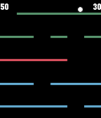

<!-- Generated by scripts/update_app_directory.py: do not edit by hand -->
[← All Pebble Developers](../developers.md)

# Ari Wilson

*1 app · Last updated 2026-10-12 · [About these lists](../about-app-lists.md)*

Links: [Pebble App Store](https://apps.repebble.com/apps/dev/ari-wilson_52a03c4b2a0bb9b0fb00000d) · [GitHub (evilrobot69)](https://github.com/evilrobot69)

<h2 class="app-name" id="app-52b5584420fef47f82000011"><a href="https://apps.repebble.com/52b5584420fef47f82000011">Falldown</a> v3.0</h2>
<a class="app-source" href="https://github.com/evilrobot69/Falldown" title="Source code" data-search-exclude>View source</a>

App

No licence Released 2013-12-21 Updated 2015-12-14

Runs on: Round 2, Time 2, Pebble 2 Duo, Pebble 2, Time Round, Time, Classic

Falldown is a game about steering a falling ball around walls of bricks. You steer with the UP and DOWN buttons or, optionally, by flicking your wrist. Your objective is not to let the ball hit…

