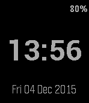

<!-- Generated by scripts/update_app_directory.py: do not edit by hand -->
[← All Pebble Developers](../developers.md)

# Arnaud Boudou

*1 watchface · Last updated 2026-10-11 · [About these lists](../about-app-lists.md)*

Links: [Pebble App Store](https://apps.repebble.com/apps/dev/arnaud-boudou_54cd0d4a66e305ca40000002) · [GitHub (aboudou)](https://github.com/aboudou) · [Website (goddess-gate.com)](https://goddess-gate.com/projects/en)

<h2 class="app-name" id="app-55e8170f0a081a59b4000005"><a href="https://apps.repebble.com/55e8170f0a081a59b4000005">YASWF (Yet Another Simple WatchFace)</a> v1.3</h2>
<a class="app-source" href="https://github.com/aboudou/Pebble_YASWF" title="Source code" data-search-exclude>View source</a>

Watchface

BSD-2-Clause Released 2015-09-03 Updated 2025-11-25

Runs on: Round 2, Time 2, Pebble 2 Duo, Pebble 2, Time Round, Time, Classic

YASWF (Yet Another Simple WatchFace) is watchface displaying essential informations in a convenient manner : hour, date, battery level, charging status, bluetooth disconnection. This watchface…

