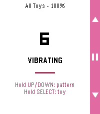

<!-- Generated by scripts/update_app_directory.py: do not edit by hand -->
[← All Pebble Developers](../developers.md)

# Arron

*1 app · Last updated 2026-10-12 · [About these lists](../about-app-lists.md)*

Links: [Pebble App Store](https://apps.repebble.com/apps/dev/arron_524aee3521fec8fbd71a5a3f) · [GitHub (MrArron)](https://github.com/MrArron)

<h2 class="app-name" id="app-4a1b7995c8d142f099d98dbb"><a href="https://apps.repebble.com/4a1b7995c8d142f099d98dbb">Lovense Remote</a> v1.2.4</h2>
<a class="app-source" href="https://github.com/MrArron/Lovense-Pebble-Control" title="Source code" data-search-exclude>View source</a>

App

CC0-1.0 Released 2026-09-16 Updated 2026-09-20

Runs on: Round 2, Time 2, Pebble 2 Duo, Pebble 2, Time Round, Time, Classic

Control your Lovense toy discreetly from your wrist. Choose an open Basic remote-control face, or a Discrete face (Analog or Digital) that looks like an ordinary watch to everyone but you —…

