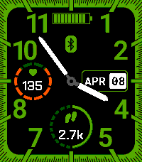
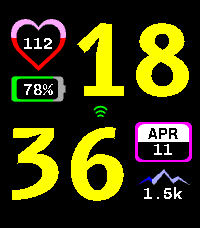

<!-- Generated by scripts/update_app_directory.py: do not edit by hand -->
[← All Pebble Developers](../developers.md)

# \_ArtCoded

*2 watchfaces · Last updated 2026-10-11 · [About these lists](../about-app-lists.md)*

Links: [Pebble App Store](https://apps.repebble.com/apps/dev/artcoded_2e1c2aef27997fd7e0a7b956) · [GitHub (art-coded)](https://github.com/art-coded)

<button type="button" data-filter="all" aria-pressed="true">All 2</button><button type="button" data-filter="watchface" aria-pressed="false">Watchfaces 2</button><button type="button" data-filter="watchapp" aria-pressed="false" disabled>Apps 0</button>

<label class="dev-sort">Sort by <select><option value="updated">Recently updated</option><option value="released">Newest release</option><option value="title">A–Z</option></select></label>

<h2 class="app-name" id="app-f732c3f3661048c0916600af"><a href="https://apps.repebble.com/f732c3f3661048c0916600af">Keep it Green</a> v1.0.2</h2>
<a class="app-source" href="https://github.com/art-coded/pebble-keepitgreen" title="Source code" data-search-exclude>View source</a>

Watchface

GPL-3.0 Released 2026-04-04 Updated 2026-04-15

Runs on: Time 2

Keep it Green is digital/analogic watchface giving you hour and date. Keep control on your daily steps target as well as your heart rate. Setting page let you (de)activate both monitors and…

<h2 class="app-name" id="app-ca02496868df44928be0239a"><a href="https://apps.repebble.com/ca02496868df44928be0239a">Contour</a> v1.0.0</h2>
<a class="app-source" href="https://github.com/art-coded/pebble-contour" title="Source code" data-search-exclude>View source</a>

Watchface

GPL-3.0 Released 2026-04-12 Updated 2026-04-12

Runs on: Time 2

Contour is a Time 2 watchface. It permits you to set and follow your daily steps count and you heart rate with a gauge based on your maximum heart rate. Connectivity icon is green when connected…

