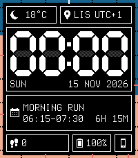

<!-- Generated by scripts/update_app_directory.py: do not edit by hand -->
[← All Pebble Developers](../developers.md)

# Artem Pendiurin

*1 watchface · Last updated 2026-11-16 · [About these lists](../about-app-lists.md)*

Links: [Pebble App Store](https://apps.repebble.com/apps/dev/artem-pendiurin_dfea7598d9f3cba0fbb57b57) · [GitHub (ErBlack)](https://github.com/ErBlack)

<h2 class="app-name" id="app-3d3c24d512f440d1b9281541"><a href="https://apps.repebble.com/3d3c24d512f440d1b9281541">Progressring</a> v1.0.1</h2>
<a class="app-source" href="https://github.com/ErBlack/progressring" title="Source code" data-search-exclude>View source</a>

Watchface

No licence Released 2026-11-15 Updated 2026-11-16

Runs on: Time 2

Like a progressbar, but in ring form: displays the progress of the day with sunrise, sunset and events around the edge. In the center: a big clock with the date, surrounded by info blocks for…

