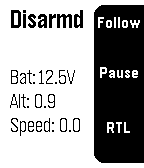

<!-- Generated by scripts/update_app_directory.py: do not edit by hand -->
[← All Pebble Developers](../developers.md)

# Artem

*2 apps · Last updated 2026-10-11 · [About these lists](../about-app-lists.md)*

Links: [Pebble App Store](https://apps.repebble.com/apps/dev/artem_550ad07084ad0239d700012d) · [GitHub (ladrower)](https://github.com/ladrower)

<button type="button" data-filter="all" aria-pressed="true">All 2</button><button type="button" data-filter="watchface" aria-pressed="false" disabled>Watchfaces 0</button><button type="button" data-filter="watchapp" aria-pressed="false">Apps 2</button>

<label class="dev-sort">Sort by <select><option value="updated">Recently updated</option><option value="released">Newest release</option><option value="title">A–Z</option></select></label>

<h2 class="app-name" id="app-569e359791e256161800002f"><a href="https://apps.repebble.com/569e359791e256161800002f">DroidPlanner2 for 3DR IRIS+</a> v1.1</h2>
<a class="app-source" href="https://github.com/ladrower/DroidPlanner-2-Pebble-forked" title="Source code" data-search-exclude>View source</a>

App

Released 2016-01-19 Updated 2016-01-19

Runs on: Round 2, Time 2, Pebble 2 Duo, Pebble 2, Time Round, Time, Classic

Original DroidPlanner 2 pebble app

<h2 class="app-name" id="app-563942a577b75e4c47000003"><a href="https://apps.repebble.com/563942a577b75e4c47000003">Arithmetics</a> v1.4</h2>
<a class="app-source" href="https://github.com/ladrower/pebble-hello" title="Source code" data-search-exclude>View source</a>

App

Released 2015-11-03 Updated 2015-11-16

Runs on: Round 2, Time 2, Pebble 2 Duo, Pebble 2, Time Round, Time, Classic

Provides simple arithmetic problems to be solved. The problem updates automatically every 5 minutes. Press select button to view the answer and proceed.

