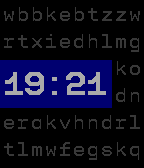

<!-- Generated by scripts/update_app_directory.py: do not edit by hand -->
[← All Pebble Developers](../developers.md)

# articld

*1 watchface · Last updated 2026-10-11 · [About these lists](../about-app-lists.md)*

Links: [Rebble App Store](https://apps.rebble.io/en_US/developer/59709aba0dfc32dd14000179/1) · [GitHub (articld)](https://github.com/articld)

<h2 class="app-name" id="app-67cc84c7b7a023024b2145d9"><a href="https://apps.rebble.io/en_US/application/67cc84c7b7a023024b2145d9">Bad Selection</a> v0.6</h2>
<a class="app-source" href="https://github.com/articld/BadSelection" title="Source code" data-search-exclude>View source</a>

Watchface

No licence Released 2025-03-08 Updated 2025-04-20 Rebble App Store

Runs on: Time 2, Pebble 2 Duo, Pebble 2, Time, Classic

This watchface was created during Rebble&#x27;s Hackathon #002! I got largely inspired by old mechanical flipboards, but the design kinda shifted with time. This watchface is currently a WIP, more…

