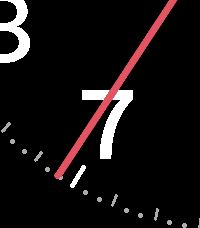

<!-- Generated by scripts/update_app_directory.py: do not edit by hand -->
[← All Pebble Developers](../developers.md)

# Artifact

*1 watchface · Last updated 2026-10-12 · [About these lists](../about-app-lists.md)*

Links: [Pebble App Store](https://apps.repebble.com/apps/dev/artifact_52e20aedb806fdcf4300018b) · [GitHub (arfct)](https://github.com/arfct) · [Website (artifact.com)](https://artifact.com)

<h2 class="app-name" id="app-72fb25c0fe5544428d71d221"><a href="https://apps.repebble.com/72fb25c0fe5544428d71d221">Arcminute</a> v2.6.0</h2>
<a class="app-source" href="https://github.com/arfct/arcminute-watchface" title="Source code" data-search-exclude>View source</a>

Watchface · <a href="https://forum.rebble.io/t/1341" title="Discuss this app on the Rebble forum" data-search-exclude>Forum thread</a>

MIT Released 2026-02-21 Updated 2026-09-11

Runs on: Round 2, Time 2, Pebble 2 Duo, Pebble 2, Time Round, Time, Classic

Formerly Chronology. Most watch faces show twelve hours so you can find one. Arcminute shows the one it is. The dial is wider than the screen and slides past through the day, so the current hour…

