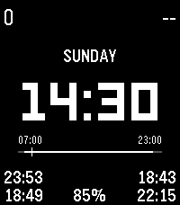

<!-- Generated by scripts/update_app_directory.py: do not edit by hand -->
[← All Pebble Developers](../developers.md)

# artyom

*1 watchface · Last updated 2026-10-12 · [About these lists](../about-app-lists.md)*

Links: [Pebble App Store](https://apps.repebble.com/apps/dev/artyom_a09cfa895c055337b6ad9385) · [GitHub (artyomxx)](https://github.com/artyomxx) · [Website (artyom.cc)](https://artyom.cc)

<h2 class="app-name" id="app-ed7cd76621eb4acb91388a58"><a href="https://apps.repebble.com/ed7cd76621eb4acb91388a58">Big and clean and all</a> v1.0.0</h2>
<a class="app-source" href="https://github.com/artyomxx/pwf-big-and-clean" title="Source code" data-search-exclude>View source</a>

Watchface · <a href="https://forum.rebble.io/t/1102" title="Discuss this app on the Rebble forum" data-search-exclude>Forum thread</a>

No licence Released 2026-06-28 Updated 2026-06-28

Runs on: Time 2

It can be just big digits. It can be no digits at all. It also have a daily timeline based on your morning wake-up time and sleep duration so you can kinda visually estimate how much time you…

