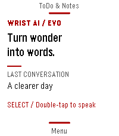

<!-- Generated by scripts/update_app_directory.py: do not edit by hand -->
[← All Pebble Developers](../developers.md)

# Asterwyn

*1 app · Last updated 2026-11-09 · [About these lists](../about-app-lists.md)*

Links: [Pebble App Store](https://apps.repebble.com/apps/dev/asterwyn_649b62ae8e146242a71da246) · [GitHub (deusaw)](https://github.com/deusaw) · [Website (paypal.me)](https://paypal.me/Asterwyn)

<h2 class="app-name" id="app-7ee7208cdc8c49a280326abd"><a href="https://apps.repebble.com/7ee7208cdc8c49a280326abd">Wrist AI Evo</a> v1.6.1.5</h2>
<a class="app-source" href="https://github.com/deusaw/Pebble-Wrist-AI" title="Source code" data-search-exclude>View source</a>

App

Other Released 2026-04-12 Updated 2026-10-22

Runs on: Round 2, Time 2, Pebble 2 Duo, Pebble 2, Time Round, Time

Wrist AI Evo — Turn wonder into words. A clearer page for your next thought. Wrist AI Evo brings a Paper-inspired interface to Wrist AI, with full-screen reading, quiet typography, colour accents…

