<!-- Generated by scripts/update_app_directory.py: do not edit by hand -->
[← All Pebble Developers](../developers.md)

# astosia

*24 watchfaces and 2 apps · Last updated 2026-10-12 · [About these lists](../about-app-lists.md)*

Links: [Pebble App Store](https://apps.repebble.com/apps/dev/astosia_58a635d30dfc320dc60003b4) · [Rebble App Store](https://apps.rebble.io/en_US/developer/58a635d30dfc320dc60003b4/1) · [GitHub (astosia)](https://github.com/astosia) · [Website (favouritehumandesign.com)](https://favouritehumandesign.com)

<button type="button" data-filter="all" aria-pressed="true">All 26</button><button type="button" data-filter="watchface" aria-pressed="false">Watchfaces 24</button><button type="button" data-filter="watchapp" aria-pressed="false">Apps 2</button>

<label class="dev-sort">Sort by <select><option value="updated">Recently updated</option><option value="released">Newest release</option><option value="title">A–Z</option></select></label>

<h2 class="app-name" id="app-5006a236677b4457a6f76364"><a href="https://apps.repebble.com/5006a236677b4457a6f76364">Hybrid Weather</a> v4.1.0</h2>
<a class="app-source" href="https://github.com/astosia/Hybrid" title="Source code" data-search-exclude>View source</a>

Watchface · <a href="https://forum.rebble.io/t/941" title="Discuss this app on the Rebble forum" data-search-exclude>Forum thread</a>

MIT Released 2026-04-04 Updated 2026-10-06

Runs on: Round 2, Time 2, Pebble 2 Duo, Pebble 2, Time Round, Time, Classic

Hybrid watchface showing both analogue &amp; digital time and Weather Features: - Tap (and tap again) to see weather, with loads of info from Open-Meteo (no API key required) or OpenWeatherMap (API…

<a class="app-shot" href="https://apps.repebble.com/6ac26e83b95ba200094d50e8" data-search-exclude>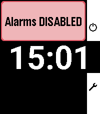</a>

<h2 class="app-name" id="app-6ac26e83b95ba200094d50e8"><a href="https://apps.repebble.com/6ac26e83b95ba200094d50e8">Gentle Wake Plus - Daily Smart Alarm Clock</a> v4.2.0</h2>
<a class="app-source" href="https://github.com/astosia/GentleWake" title="Source code" data-search-exclude>View source</a>

App

MIT Released 2026-10-04 Updated 2026-10-04

Runs on: Round 2, Time 2, Pebble 2 Duo, Pebble 2, Time Round, Time, Classic

Evolution of the excellent original by SeaPea software This version adds: - Native Layouts for PT2 and PR2 - Alarm Sounds for PT2 and P2Duo - multiple options including some of the system options…

<h2 class="app-name" id="app-6a7a1b2ebb2e890009f6b103"><a href="https://apps.repebble.com/6a7a1b2ebb2e890009f6b103">Tangent</a> v4.3.0</h2>
<a class="app-source" href="https://github.com/astosia/tangent" title="Source code" data-search-exclude>View source</a>

Watchface · <a href="https://forum.rebble.io/t/1224" title="Discuss this app on the Rebble forum" data-search-exclude>Forum thread</a>

MIT Released 2026-08-10 Updated 2026-09-27

Runs on: Round 2, Time 2, Pebble 2 Duo, Pebble 2, Time Round, Time, Classic

Inspired by the Tangente watch by Nomos Features: - Fully configurable colours, with presets or custom colours - Numbers or Roman Numerals on the dial - Configurable hand widths &amp; lengths - Vibe &amp;…

<a class="app-shot" href="https://apps.repebble.com/6aad8bd5d8f3d60008ca0b99" data-search-exclude>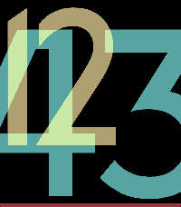</a>

<h2 class="app-name" id="app-6aad8bd5d8f3d60008ca0b99"><a href="https://apps.repebble.com/6aad8bd5d8f3d60008ca0b99">Monolith</a> v1.8.0</h2>
<a class="app-source" href="https://github.com/astosia/monolith" title="Source code" data-search-exclude>View source</a>

Watchface · <a href="https://forum.rebble.io/t/1369" title="Discuss this app on the Rebble forum" data-search-exclude>Forum thread</a>

MIT Released 2026-09-18 Updated 2026-09-21

Runs on: Round 2, Time 2, Pebble 2 Duo, Pebble 2, Time Round, Time, Classic

Simple watchface with really large easy to read digits, and configurable layout and colours. Live preview in Settings page Features: - Show or hide battery meter (line at the bottom of the screen)…

<a class="app-shot" href="https://apps.repebble.com/5af6e195461a8d22e3000cc4" data-search-exclude>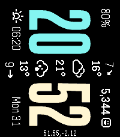</a>

<h2 class="app-name" id="app-5af6e195461a8d22e3000cc4"><a href="https://apps.repebble.com/5af6e195461a8d22e3000cc4">phoenix rotated</a> v4.0.0</h2>
<a class="app-source" href="https://github.com/astosia/phoenix-90-or-270" title="Source code" data-search-exclude>View source</a>

Watchface · <a href="https://forum.rebble.io/t/1307" title="Discuss this app on the Rebble forum" data-search-exclude>Forum thread</a>

No licence Released 2018-05-12 Updated 2026-08-31

Runs on: Round 2, Time 2, Pebble 2 Duo, Pebble 2, Time Round, Time, Classic

Phoenix is a rotated watchface showing current weather information (temperature, conditions and wind speed) through the centre of the watchface. V4 adds Emery Pebble Time 2 support, and the…

<a class="app-shot" href="https://apps.repebble.com/69ee8a7097500300095a4ac2" data-search-exclude>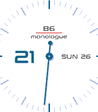</a>

<h2 class="app-name" id="app-69ee8a7097500300095a4ac2"><a href="https://apps.repebble.com/69ee8a7097500300095a4ac2">monologue</a> v2.3.0</h2>
<a class="app-source" href="https://github.com/astosia/monologue" title="Source code" data-search-exclude>View source</a>

Watchface · <a href="https://forum.rebble.io/t/914" title="Discuss this app on the Rebble forum" data-search-exclude>Forum thread</a>

GPL-3.0 Released 2026-04-26 Updated 2026-08-24

Runs on: Round 2, Time 2, Pebble 2 Duo, Pebble 2, Time Round, Time, Classic

Watchface inspired by the Skagen Mono watch: has a single analogue minute hand, and digital hours Features: - V2 adds ability to swap minutes and hours, and to modify size &amp; style of the analogue…

<a class="app-shot" href="https://apps.repebble.com/6b5e3c1ac0a849e09de40b22" data-search-exclude>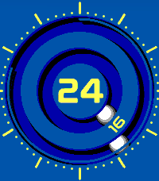</a>

<h2 class="app-name" id="app-6b5e3c1ac0a849e09de40b22"><a href="https://apps.repebble.com/6b5e3c1ac0a849e09de40b22">Bearing</a> v4.0</h2>
<a class="app-source" href="https://github.com/astosia/Bearing" title="Source code" data-search-exclude>View source</a>

Watchface · <a href="https://forum.rebble.io/t/915" title="Discuss this app on the Rebble forum" data-search-exclude>Forum thread</a>

GPL-3.0 Released 2026-04-12 Updated 2026-06-20

Runs on: Round 2, Time 2, Pebble 2 Duo, Pebble 2, Time Round, Time, Classic

Analogue &amp; Digital watchface styled after magnetic ball watches. The hands rolls around the ball race of the bearing. Works on all pebbles. Features &amp; Options: - NEW in V2: Gravity Mode (all…

<a class="app-shot" href="https://apps.rebble.io/en_US/application/68aa0fab4d6161000851b5ae" data-search-exclude>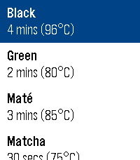</a>

<h2 class="app-name" id="app-68aa0fab4d6161000851b5ae"><a href="https://apps.rebble.io/en_US/application/68aa0fab4d6161000851b5ae">Tea&#x27;s Ready</a> v3.1</h2>
<a class="app-source" href="https://github.com/astosia/Tea/tree/clay" title="Source code" data-search-exclude>View source</a>

App · <a href="https://forum.rebble.io/t/138" title="Discuss this app on the Rebble forum" data-search-exclude>Forum thread</a>

No licence Released 2025-08-23 Updated 2026-05-11 Rebble App Store

Runs on: Round 2, Time 2, Pebble 2 Duo, Pebble 2, Time Round, Time, Classic

Patched version of the excellent Tea&#x27;s Ready Tea Timer by Léomike Hébert. Updated for Pebble Time 2 and Pebble Round 2, and now works with Clay settings Ever forgotten to take the teabag out of…

<h2 class="app-name" id="app-69b5bf5df7b0f40009c93e68"><a href="https://apps.rebble.io/en_US/application/69b5bf5df7b0f40009c93e68">Hybrid</a> v2.0</h2>
<a class="app-source" href="https://github.com/astosia/Hybrid" title="Source code" data-search-exclude>View source</a>

Watchface · <a href="https://forum.rebble.io/t/768" title="Discuss this app on the Rebble forum" data-search-exclude>Forum thread</a>

MIT Released 2026-03-14 Updated 2026-03-22 Rebble App Store

Runs on: Round 2, Time 2, Pebble 2 Duo, Pebble 2, Time Round, Time, Classic

Hybrid watchface showing both analogue and digital time Features: - Change style from round to rectangular (not on round watches) - Fully configurable colours, with several presets - Vibe and icon…

<h2 class="app-name" id="app-68ebe1952a50310009ee1b3e"><a href="https://apps.rebble.io/en_US/application/68ebe1952a50310009ee1b3e">Helix</a> v3.5</h2>
<a class="app-source" href="https://github.com/astosia/Helix" title="Source code" data-search-exclude>View source</a>

Watchface · <a href="https://forum.rebble.io/t/556" title="Discuss this app on the Rebble forum" data-search-exclude>Forum thread</a>

MIT Released 2025-10-12 Updated 2026-03-16 Rebble App Store

Runs on: Round 2, Time 2, Pebble 2 Duo, Pebble 2, Time Round, Time, Classic

Dual Dial configurable watchface, with zoomed in hours &amp; minutes. Overlapping dials create a DNA-like helix Features: - Optional second timezone using timeapi.io, shows second timezone underneath…

<a class="app-shot" href="https://apps.rebble.io/en_US/application/69b71728acec7b00092d0954" data-search-exclude>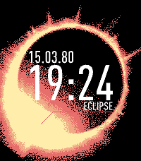</a>

<h2 class="app-name" id="app-69b71728acec7b00092d0954"><a href="https://apps.rebble.io/en_US/application/69b71728acec7b00092d0954">Eclipse</a> v1.0</h2>
<a class="app-source" href="https://github.com/astosia/Eclipse" title="Source code" data-search-exclude>View source</a>

Watchface · <a href="https://forum.rebble.io/t/774" title="Discuss this app on the Rebble forum" data-search-exclude>Forum thread</a>

MIT Released 2026-03-15 Updated 2026-03-15 Rebble App Store

Runs on: Round 2, Time 2, Pebble 2 Duo, Pebble 2, Time Round, Time

Westworld inspired watchface, based on Serac&#x27;s Rehoboam watch (also looks quite a lot like a Solar Eclipse) Background updates every minute as the Divergence progresses Features: - Auto-detection…

<a class="app-shot" href="https://apps.rebble.io/en_US/application/62ee9320e595b3000a939a3e" data-search-exclude>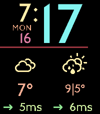</a>

<h2 class="app-name" id="app-62ee9320e595b3000a939a3e"><a href="https://apps.rebble.io/en_US/application/62ee9320e595b3000a939a3e">Elizabeth</a> v6.5</h2>
<a class="app-source" href="https://github.com/astosia/Elizabeth" title="Source code" data-search-exclude>View source</a>

Watchface · <a href="https://forum.rebble.io/t/669" title="Discuss this app on the Rebble forum" data-search-exclude>Forum thread</a>

GPL-3.0 Released 2022-08-06 Updated 2026-02-22 Rebble App Store

Runs on: Round 2, Time 2, Pebble 2 Duo, Pebble 2, Time Round, Time, Classic

Elizabeth is an easy to read pebble watchface with weather &amp; steps, using the Elizabeth Line font from the London Underground. Features: - Fully configurable colours - Toggle on configuration…

<h2 class="app-name" id="app-5dcdcbc9c393f52a5b8fa510"><a href="https://apps.rebble.io/en_US/application/5dcdcbc9c393f52a5b8fa510">Oswald Vertical</a> v2.0</h2>
<a class="app-source" href="https://github.com/astosia/oswald" title="Source code" data-search-exclude>View source</a>

Watchface · <a href="https://forum.rebble.io/t/661" title="Discuss this app on the Rebble forum" data-search-exclude>Forum thread</a>

No licence Released 2019-11-14 Updated 2026-02-15 Rebble App Store

Runs on: Round 2, Time 2, Pebble 2 Duo, Pebble 2, Time Round, Time, Classic

Homage to the excellent watsface. This version adds configurable colours, 12h/24h option, and works on every type of pebble (including Pebble Time 2). Vibrates on disconnect (not during quiet…

<a class="app-shot" href="https://apps.rebble.io/en_US/application/648e2420741dd4022e8ed352" data-search-exclude>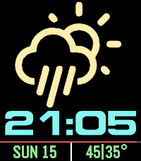</a>

<h2 class="app-name" id="app-648e2420741dd4022e8ed352"><a href="https://apps.rebble.io/en_US/application/648e2420741dd4022e8ed352">Big Weather</a> v4.0</h2>
<a class="app-source" href="https://github.com/astosia/WeatherOWM3" title="Source code" data-search-exclude>View source</a>

Watchface · <a href="https://forum.rebble.io/t/664" title="Discuss this app on the Rebble forum" data-search-exclude>Forum thread</a>

No licence Released 2023-06-17 Updated 2026-02-15 Rebble App Store

Runs on: Round 2, Time 2, Pebble 2 Duo, Pebble 2, Time Round, Time

Massive weather icon watchface Features: - Configurable colours - Weather based on phone GPS or a manually entered latitude &amp; longitude - Choice of two weather apis: Open-Meteo (no api key needed)…

<h2 class="app-name" id="app-68c721a1e9a54400093e1c64"><a href="https://apps.rebble.io/en_US/application/68c721a1e9a54400093e1c64">Titanium</a> v2.0</h2>
<a class="app-source" href="https://github.com/astosia/Titanium" title="Source code" data-search-exclude>View source</a>

Watchface · <a href="https://forum.rebble.io/t/625" title="Discuss this app on the Rebble forum" data-search-exclude>Forum thread</a>

MIT Released 2025-09-14 Updated 2026-02-08 Rebble App Store

Runs on: Round 2, Time 2, Pebble 2 Duo, Pebble 2, Time Round, Time, Classic

Analogue watchface with a shadow. Inspired by the inset dial on my favourite Skagen titanium watch Works on all pebble screen sizes, including Pebble Time 2 - Configurable colours - Optional…

<h2 class="app-name" id="app-67ce30a8d2acb303aedd4abe"><a href="https://apps.rebble.io/en_US/application/67ce30a8d2acb303aedd4abe">Underground</a> v7.5</h2>
<a class="app-source" href="https://github.com/astosia/Underground" title="Source code" data-search-exclude>View source</a>

Watchface · <a href="https://forum.rebble.io/t/413" title="Discuss this app on the Rebble forum" data-search-exclude>Forum thread</a>

No licence Released 2025-03-10 Updated 2026-01-04 Rebble App Store

Runs on: Round 2, Time 2, Pebble 2 Duo, Pebble 2, Time Round, Time, Classic

Underground is a customizable, easy to read, large font watchface using the London Underground font. Now with optional weather! Shake or tap to show weather for 10 seconds. Weather uses…

<a class="app-shot" href="https://apps.rebble.io/en_US/application/5dcdcb71c393f521d8965ad5" data-search-exclude>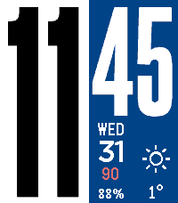</a>

<h2 class="app-name" id="app-5dcdcb71c393f521d8965ad5"><a href="https://apps.rebble.io/en_US/application/5dcdcb71c393f521d8965ad5">Phoenix Big</a> v4.2</h2>
<a class="app-source" href="https://github.com/astosia/phoenix_big" title="Source code" data-search-exclude>View source</a>

Watchface · <a href="https://forum.rebble.io/t/402" title="Discuss this app on the Rebble forum" data-search-exclude>Forum thread</a>

No licence Released 2019-11-14 Updated 2025-12-31 Rebble App Store

Runs on: Round 2, Time 2, Pebble 2 Duo, Pebble 2, Time Round, Time, Classic

Phoenix Big is a customisable, easy to read, large font watchface using the Steelfish font. Shows optional weather, sunset/sunrise and steps Features: - Auto-detection of 12h/24h based on your…

<a class="app-shot" href="https://apps.rebble.io/en_US/application/60a4db6a1342ae00af2195e0" data-search-exclude>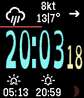</a>

<h2 class="app-name" id="app-60a4db6a1342ae00af2195e0"><a href="https://apps.rebble.io/en_US/application/60a4db6a1342ae00af2195e0">Quartzite</a> v3.5</h2>
<a class="app-source" href="https://github.com/astosia/Quartzite" title="Source code" data-search-exclude>View source</a>

Watchface

GPL-3.0 Released 2021-05-19 Updated 2025-05-11 Rebble App Store

Runs on: Round 2, Time 2, Pebble 2 Duo, Pebble 2, Time Round, Time, Classic

Quartzite is an easy to read watchface with weather, steps and multiple time font choices*. Features: - Fully configurable colours - Toggle on configuration screen to turn off pebble health (turns…

<a class="app-shot" href="https://apps.rebble.io/en_US/application/637a6466c6c24a000a815e8b" data-search-exclude>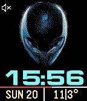</a>

<h2 class="app-name" id="app-637a6466c6c24a000a815e8b"><a href="https://apps.rebble.io/en_US/application/637a6466c6c24a000a815e8b">Alienwear</a> v2.5</h2>
<a class="app-source" href="https://github.com/astosia/Alien-head" title="Source code" data-search-exclude>View source</a>

Watchface

No licence Released 2022-11-20 Updated 2025-05-11 Rebble App Store

Runs on: Round 2, Time 2, Pebble 2 Duo, Pebble 2, Time Round, Time, Classic

Alienware inspired weather watchface. Alien picture now changes to show rain, snow or cloud (select whether this is current or forecast in the phone config menu). Features: - Dark or light theme…

<a class="app-shot" href="https://apps.rebble.io/en_US/application/5b185daef38588775f000f54" data-search-exclude>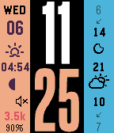</a>

<h2 class="app-name" id="app-5b185daef38588775f000f54"><a href="https://apps.rebble.io/en_US/application/5b185daef38588775f000f54">phoenix too</a> v2.0</h2>
<a class="app-source" href="https://github.com/astosia/Phoenix_vertical" title="Source code" data-search-exclude>View source</a>

Watchface

No licence Released 2018-06-06 Updated 2024-11-24 Rebble App Store

Runs on: Round 2, Time 2, Pebble 2 Duo, Pebble 2, Time Round, Time, Classic

Phoenix Vertical is a customizable, easy to read, large font watchface using the Steelfish font. Works on all types of pebble. Features: - Auto-detection of 12h/24h based on your watch settings …

<a class="app-shot" href="https://apps.rebble.io/en_US/application/5af6ef78f38588a1370009b5" data-search-exclude>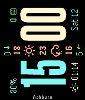</a>

<h2 class="app-name" id="app-5af6ef78f38588a1370009b5"><a href="https://apps.rebble.io/en_US/application/5af6ef78f38588a1370009b5">phoenix 270°</a> v3.0</h2>
<a class="app-source" href="https://github.com/astosia/phoenix-90-or-270" title="Source code" data-search-exclude>View source</a>

Watchface

No licence Released 2018-05-12 Updated 2024-11-24 Rebble App Store

Runs on: Round 2, Time 2, Pebble 2 Duo, Pebble 2, Time Round, Time, Classic

Phoenix is a rotated watchface showing current weather information (temperature, conditions and wind speed) through the centre of the watchface. Also shows steps (for Pebble Time and Pebble 2)…

<a class="app-shot" href="https://apps.rebble.io/en_US/application/5af60dbb461a8d6035003bc7" data-search-exclude>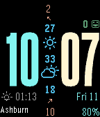</a>

<h2 class="app-name" id="app-5af60dbb461a8d6035003bc7"><a href="https://apps.rebble.io/en_US/application/5af60dbb461a8d6035003bc7">phoenix</a> v3.0</h2>
<a class="app-source" href="https://github.com/astosia/phoenix" title="Source code" data-search-exclude>View source</a>

Watchface

No licence Released 2018-05-11 Updated 2024-11-24 Rebble App Store

Runs on: Round 2, Time 2, Pebble 2 Duo, Pebble 2, Time Round, Time, Classic

Phoenix is a customizable watchface showing current weather information (temperature, conditions and wind speed) through the centre of the watchface. Also shows steps (for Pebble Time and Pebble…

<h2 class="app-name" id="app-648dcafc741dd40198625106"><a href="https://apps.rebble.io/en_US/application/648dcafc741dd40198625106">Tall Time</a> v1.6</h2>
<a class="app-source" href="https://github.com/astosia/TallTime_Simple" title="Source code" data-search-exclude>View source</a>

Watchface

No licence Released 2023-06-17 Updated 2023-06-17 Rebble App Store

Runs on: Round 2, Time 2, Pebble 2 Duo, Pebble 2, Time Round, Time, Classic

Simple Tall Time, with Date at the bottom and battery bar at the top - Shows Quiet Time icon at bottom left when quiet time is on - Configurable colours - Vibrates on bluetooth disconnection…

<a class="app-shot" href="https://apps.rebble.io/en_US/application/60ac17751342ae016acb0900" data-search-exclude>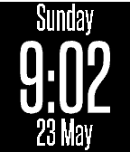</a>

<h2 class="app-name" id="app-60ac17751342ae016acb0900"><a href="https://apps.rebble.io/en_US/application/60ac17751342ae016acb0900">Chimaera</a> v1.0</h2>
<a class="app-source" href="https://github.com/astosia/Chimaera" title="Source code" data-search-exclude>View source</a>

Watchface

GPL-3.0 Released 2021-05-24 Updated 2021-05-24 Rebble App Store

Runs on: Round 2, Time 2, Pebble 2 Duo, Pebble 2, Time Round, Time, Classic

Chimaera is a simple configurable watchface Options include: - Local language for day of the week and month (based on watch language selected in the phone app): English, German, French, Spanish…

<a class="app-shot" href="https://apps.rebble.io/en_US/application/5ec99be43dd31061b1c0d9e0" data-search-exclude>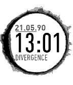</a>

<h2 class="app-name" id="app-5ec99be43dd31061b1c0d9e0"><a href="https://apps.rebble.io/en_US/application/5ec99be43dd31061b1c0d9e0">Rehoboam</a> v1.0</h2>
<a class="app-source" href="https://github.com/astosia/Rehoboam" title="Source code" data-search-exclude>View source</a>

Watchface

No licence Released 2020-05-23 Updated 2020-05-23 Rebble App Store

Runs on: Round 2, Time 2, Pebble 2 Duo, Pebble 2, Time Round, Time, Classic

Westworld inspired watchface, based on Serac&#x27;s watch. Features: - Auto-detection of 12h/24h based on your watch settings - Date.Month.Battery complication Options: - Choose background and text…

<a class="app-shot" href="https://apps.rebble.io/en_US/application/5aecbeebf38588a252000834" data-search-exclude>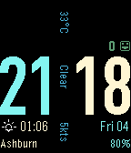</a>

<h2 class="app-name" id="app-5aecbeebf38588a252000834"><a href="https://apps.rebble.io/en_US/application/5aecbeebf38588a252000834">90° DIN</a> v1.3</h2>
<a class="app-source" href="https://github.com/astosia/din-90" title="Source code" data-search-exclude>View source</a>

Watchface

No licence Released 2018-05-04 Updated 2018-05-12 Rebble App Store

Runs on: Round 2, Time 2, Pebble 2 Duo, Pebble 2, Time Round, Time, Classic

90° DIN is a customizable watchface that shows current weather information (temperature, conditions and wind speed in knots) at 90 degrees vertically through the centre of the watchface. Also…

