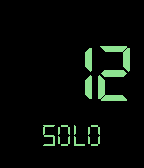

<!-- Generated by scripts/update_app_directory.py: do not edit by hand -->
[← All Pebble Developers](../developers.md)

# Athene Allen

*1 watchface · Last updated 2026-10-11 · [About these lists](../about-app-lists.md)*

Links: [Pebble App Store](https://apps.repebble.com/apps/dev/athene-allen_57caf385be5ad0f2d80001bf) · [GitHub (gnargle)](https://github.com/gnargle)

<h2 class="app-name" id="app-57cea0264a6ad9d300000077"><a href="https://apps.repebble.com/57cea0264a6ad9d300000077">Virtue&#x27;s Last Reward</a> v1.1</h2>
<a class="app-source" href="https://github.com/gnargle/VLRWatch" title="Source code" data-search-exclude>View source</a>

Watchface

Released 2016-09-06 Updated 2016-09-12

Runs on: Round 2, Time 2, Time Round, Time

A watchface inspired by Zero Escape: Virtue&#x27;s Last Reward and this face by weaversway. https://apps.getpebble.com/en_US/application/5733bba2f68e7b31a9000002 The big number is the current hour, and…

