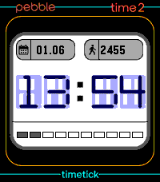
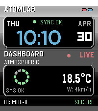
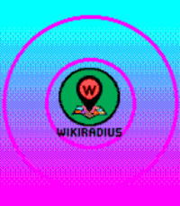
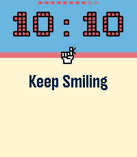
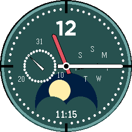
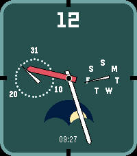
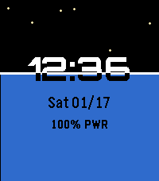
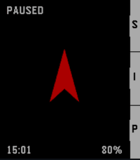

<!-- Generated by scripts/update_app_directory.py: do not edit by hand -->
[← All Pebble Developers](../developers.md)

# atomlabor

*8 watchfaces and 3 apps · Last updated 2026-10-12 · [About these lists](../about-app-lists.md)*

Links: [Pebble App Store](https://apps.repebble.com/apps/dev/atomlabor_5c1e0bc226259d0001915df5) · [GitHub (atomlabor)](https://github.com/atomlabor) · [Website (atomlabor.de)](https://atomlabor.de)

<button type="button" data-filter="all" aria-pressed="true">All 11</button><button type="button" data-filter="watchface" aria-pressed="false">Watchfaces 8</button><button type="button" data-filter="watchapp" aria-pressed="false">Apps 3</button>

<label class="dev-sort">Sort by <select><option value="updated">Recently updated</option><option value="released">Newest release</option><option value="title">A–Z</option></select></label>

<h2 class="app-name" id="app-7bfb5d27ba6c444cb04e646b"><a href="https://apps.repebble.com/7bfb5d27ba6c444cb04e646b">TimeTick</a> v1.3.0</h2>
<a class="app-source" href="https://github.com/atomlabor/TimeTick-only-Watchface" title="Source code" data-search-exclude>View source</a>

Watchface

No licence Released 2026-06-02 Updated 2026-06-03

Runs on: Time 2

TimeTick – Minimalist Precision for Pebble TimeTick is a clean, modern watchface designed for those who appreciate glanceable information without the clutter. Built with a focus on essential data…

<h2 class="app-name" id="app-67ab20fdc6af4c228d04f055"><a href="https://apps.repebble.com/67ab20fdc6af4c228d04f055">TimeTick Watchface</a> v1.0.0</h2>
<a class="app-source" href="https://github.com/atomlabor/TimeTick" title="Source code" data-search-exclude>View source</a>

App

No licence Released 2026-06-01 Updated 2026-06-01

Runs on: Time 2

This is my first attempt at a touchscreen watch face. Here you can view the time, steps, date and battery information, and if you tap the time, a countdown timer opens. Set it using the…

<h2 class="app-name" id="app-185892fdf82e4e89849309e3"><a href="https://apps.repebble.com/185892fdf82e4e89849309e3">ATOMLAB</a> v1.6.0</h2>
<a class="app-source" href="https://github.com/atomlabor/atomlab" title="Source code" data-search-exclude>View source</a>

Watchface

No licence Released 2026-04-30 Updated 2026-05-02

Runs on: Round 2, Time 2, Pebble 2 Duo, Pebble 2, Time Round, Time, Classic

ATOMLAB is a clean, telemetry-inspired watchface designed for the Pebble ecosystem. It features a distinctive 3D-layered dashboard layout that provides critical data at a glance without cluttering…

<h2 class="app-name" id="app-9b37bbba750e4a5e96da4d78"><a href="https://apps.repebble.com/9b37bbba750e4a5e96da4d78">WikiRadius</a> v3.4</h2>
<a class="app-source" href="https://github.com/atomlabor/WikiRadius" title="Source code" data-search-exclude>View source</a>

App

No licence Released 2026-04-22 Updated 2026-04-25

Runs on: Round 2, Time 2, Pebble 2 Duo, Pebble 2, Time Round, Time, Classic

Whether you are a tourist in a new city or a local history enthusiast, WikiRadius turns a simple walk into an educational journey.

<h2 class="app-name" id="app-6f211f5a1ba9407db5a2cb88"><a href="https://apps.repebble.com/6f211f5a1ba9407db5a2cb88">Remember Me</a> v1.2</h2>
<a class="app-source" href="https://github.com/atomlabor/remember-me" title="Source code" data-search-exclude>View source</a>

Watchface

No licence Released 2026-04-13 Updated 2026-04-14

Runs on: Round 2, Time 2, Pebble 2 Duo, Pebble 2, Time Round, Time, Classic

Subconscious Focus. On the Run. Remember Me is not just another task manager or a sticky note on your wrist—it is a cognitive tool designed to keep your most important intentions where they…

<h2 class="app-name" id="app-32da653d63d14abb8a160c0e"><a href="https://apps.repebble.com/32da653d63d14abb8a160c0e">Binary Glow</a> v1.0</h2>
<a class="app-source" href="https://github.com/atomlabor/binary-glow" title="Source code" data-search-exclude>View source</a>

Watchface

No licence Released 2026-04-10 Updated 2026-04-10

Runs on: Round 2, Time 2, Pebble 2 Duo, Pebble 2, Time Round, Time, Classic

A futuristic, high-tech watchface for the Pebble ecosystem. Binary Glow Ultra combines a classic &quot;Matrix&quot; aesthetic with a modern HUD (Heads-Up Display) feel, featuring dynamic animations and…

<h2 class="app-name" id="app-5f697808141542259ee82241"><a href="https://apps.repebble.com/5f697808141542259ee82241">Now: Time</a> v1.0</h2>
<a class="app-source" href="https://github.com/atomlabor/Now-Time" title="Source code" data-search-exclude>View source</a>

Watchface · <a href="https://forum.rebble.io/t/850" title="Discuss this app on the Rebble forum" data-search-exclude>Forum thread</a>

No licence Released 2026-04-09 Updated 2026-04-09

Runs on: Round 2, Time 2, Pebble 2 Duo, Pebble 2, Time Round, Time, Classic

NOW: Time - The Retro MP3 Watchface Turn your Pebble into a classic digital music player. NOW: Time combines pure early-2000s nostalgia with modern smartwatch features, bringing your current…

<h2 class="app-name" id="app-47f0856e24654a89b689f12a"><a href="https://apps.repebble.com/47f0856e24654a89b689f12a">VANTAGE Round</a> v2.1</h2>
<a class="app-source" href="https://github.com/atomlabor" title="Source code" data-search-exclude>View source</a>

Watchface

Released 2026-02-26 Updated 2026-02-27

Runs on: Round 2, Time Round

VANTAGE Round is a sophisticated, data-rich analog watchface tailored specifically for the circular displays of the Pebble Time Round (Chalk) and the high-resolution Pebble Round 2 (Gabbro)…

<h2 class="app-name" id="app-6970a55f04726500096d9975"><a href="https://apps.repebble.com/6970a55f04726500096d9975">VANTAGE</a> v2.1</h2>
<a class="app-source" href="https://github.com/atomlabor/vantage" title="Source code" data-search-exclude>View source</a>

Watchface · <a href="https://forum.rebble.io/t/540" title="Discuss this app on the Rebble forum" data-search-exclude>Forum thread</a>

No licence Released 2026-01-21 Updated 2026-02-27

Runs on: Time 2, Pebble 2 Duo, Pebble 2, Time, Classic

VANTAGE is a high-precision analog watchface, now completely rebuilt and optimized for the entire Pebble ecosystem (Time 2, Time, Pebble 2, and Classic). Clean, calm, and made for everyday use…

<h2 class="app-name" id="app-696770ea0bd367000908977b"><a href="https://apps.repebble.com/696770ea0bd367000908977b">AtomWave</a> v2.2</h2>
<a class="app-source" href="https://github.com/atomlabor/atomwave" title="Source code" data-search-exclude>View source</a>

Watchface · <a href="https://forum.rebble.io/t/490" title="Discuss this app on the Rebble forum" data-search-exclude>Forum thread</a>

MIT Released 2026-01-14 Updated 2026-01-19

Runs on: Round 2, Time 2, Pebble 2 Duo, Pebble 2, Time Round, Time, Classic

Time in Flow. AtomWave 2.2 visualises the passing of time through organic fluid physics. Watch as your screen fills with water, rising from the bottom at minute 0 to full immersion by minute 60…

<h2 class="app-name" id="app-6965fe1b38332800099df680"><a href="https://apps.repebble.com/6965fe1b38332800099df680">PureNavi</a> v2.0</h2>
<a class="app-source" href="https://github.com/atomlabor/purenavi-pebble/tree/main" title="Source code" data-search-exclude>View source</a>

App · <a href="https://forum.rebble.io/t/485" title="Discuss this app on the Rebble forum" data-search-exclude>Forum thread</a>

MIT Released 2026-01-13 Updated 2026-01-15

Runs on: Round 2, Time 2, Pebble 2 Duo, Pebble 2, Time Round, Time, Classic

PureNavi is a minimalist, highly efficient straight-line navi. Instead of distracting you with complex maps, PureNavi delivers navigation in its purest form. A single arrow and the exact distance…

