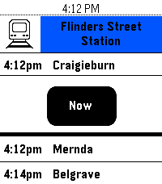

<!-- Generated by scripts/update_app_directory.py: do not edit by hand -->
[← All Pebble Developers](../developers.md)

# audietron171

*1 app · Last updated 2026-10-12 · [About these lists](../about-app-lists.md)*

Links: [Pebble App Store](https://apps.repebble.com/apps/dev/audietron171_091e5b5a39f202c65ef4b4bd) · [GitHub (audietron171)](https://github.com/audietron171)

<h2 class="app-name" id="app-c1696238887342beb6459e8d"><a href="https://apps.repebble.com/c1696238887342beb6459e8d">PebbleMetro</a> v2.0.5</h2>
<a class="app-source" href="https://github.com/audietron171/pebblemetro" title="Source code" data-search-exclude>View source</a>

App · <a href="https://forum.rebble.io/t/1230" title="Discuss this app on the Rebble forum" data-search-exclude>Forum thread</a>

No licence Released 2026-08-14 Updated 2026-08-14

Runs on: Time 2, Pebble 2 Duo, Pebble 2, Time, Classic

PebbleMetro is a simple watch-app that allows you to display upcoming departures from your favourite stops using the Melbourne PTV API. Support’s all stops supported by the API including metro…

