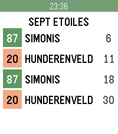

<!-- Generated by scripts/update_app_directory.py: do not edit by hand -->
[← All Pebble Developers](../developers.md)

# Aurélien Ooms

*1 app · Last updated 2026-10-11 · [About these lists](../about-app-lists.md)*

Links: [Rebble App Store](https://apps.rebble.io/en_US/developer/57dd45002d0cc8c5a400025a/1) · [GitHub (aureooms)](https://github.com/aureooms) · [Website (aureooms.github.io)](https://aureooms.github.io/pebble-stib-mivb)

<h2 class="app-name" id="app-5864e58f2ee431bb220001b2"><a href="https://apps.rebble.io/en_US/application/5864e58f2ee431bb220001b2">stib-mivb</a> v1.5</h2>
<a class="app-source" href="https://github.com/aureooms/pebble-stib-mivb" title="Source code" data-search-exclude>View source</a>

App

AGPL-3.0 Released 2016-12-29 Updated 2017-01-27 Rebble App Store

Runs on: Round 2, Time 2, Pebble 2 Duo, Pebble 2, Time Round, Time, Classic

Displays Brussels&#x27;s STIB-MIVB bus, tram and metro network realtime schedule for the ten closest stops. Works with phone and geolocation only. No configuration. Short-press select once to display…

