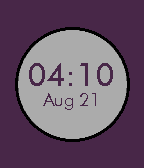

<!-- Generated by scripts/update_app_directory.py: do not edit by hand -->
[← All Pebble Developers](../developers.md)

# Austin Li

*1 watchface · Last updated 2026-10-12 · [About these lists](../about-app-lists.md)*

Links: [Pebble App Store](https://apps.repebble.com/apps/dev/austin-li_547fb31d8164e13d570000c5) · [GitHub (Austinite800)](https://github.com/Austinite800)

<h2 class="app-name" id="app-57b6b991f01b53ee0c00074e"><a href="https://apps.repebble.com/57b6b991f01b53ee0c00074e">Mini Watch</a> v1.3</h2>
<a class="app-source" href="https://github.com/Austinite800/mini-watch" title="Source code" data-search-exclude>View source</a>

Watchface

No licence Released 2016-08-19 Updated 2016-08-23

Runs on: Round 2, Time 2, Pebble 2 Duo, Pebble 2, Time Round, Time, Classic

Enjoy this highly customizable watchface with the new pebble-clay configuration settings page! Choose from digital and analog clock types, and accurate, sunlight-corrected color options. This…

