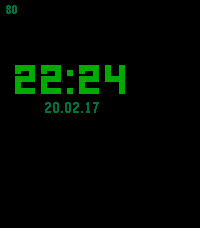

<!-- Generated by scripts/update_app_directory.py: do not edit by hand -->
[← All Pebble Developers](../developers.md)

# Avamander

*1 watchface · Last updated 2026-10-12 · [About these lists](../about-app-lists.md)*

Links: [Rebble App Store](https://apps.rebble.io/en_US/developer/58776d32e09e63748e000788/1) · [GitHub (Avamander)](https://github.com/Avamander)

<h2 class="app-name" id="app-58a98fdb6ca387b01a0005a8"><a href="https://apps.rebble.io/en_US/application/58a98fdb6ca387b01a0005a8">Yet Another Watchface</a> v1.2</h2>
<a class="app-source" href="https://github.com/Avamander/YetAnotherWatchFace" title="Source code" data-search-exclude>View source</a>

Watchface

GPL-3.0 Released 2017-02-19 Updated 2017-02-20 Rebble App Store

Runs on: Round 2, Time 2, Pebble 2 Duo, Pebble 2, Time Round, Time, Classic

Really minimal watchface that&#x27;s just designed to be simple, no configuration, no slowdowns, no nothing else. It just shows the battery status, date, time and if the bluetooth connection has…

