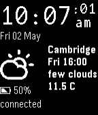

<!-- Generated by scripts/update_app_directory.py: do not edit by hand -->
[← All Pebble Developers](../developers.md)

# Ave Wrigley

*1 watchface · Last updated 2026-10-12 · [About these lists](../about-app-lists.md)*

Links: [Pebble App Store](https://apps.repebble.com/apps/dev/ave-wrigley_52b201ddb70e1c66a300002e) · [GitHub (avewrigley)](https://github.com/avewrigley)

<h2 class="app-name" id="app-52b214b18c0815094d000064"><a href="https://apps.repebble.com/52b214b18c0815094d000064">Battery Monitor Watchface</a> v1.0.31</h2>
<a class="app-source" href="https://github.com/avewrigley/pebble-batttery-monitor" title="Source code" data-search-exclude>View source</a>

Watchface

No licence Released 2013-12-18 Updated 2014-06-23

Runs on: Time 2, Pebble 2 Duo, Pebble 2, Time, Classic

Simple watch face, displaying time / date, location, local weather, and bluetooth connection / battery status. Vibrates when battery low / bluetooth disconnected. Cycles 3 hour forecasts. Tap to…

