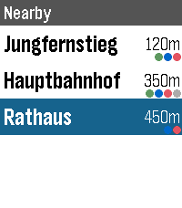

<!-- Generated by scripts/update_app_directory.py: do not edit by hand -->
[← All Pebble Developers](../developers.md)

# ave

*1 app · Last updated 2026-10-12 · [About these lists](../about-app-lists.md)*

Links: [Rebble App Store](https://apps.rebble.io/en_US/developer/532c736a9df2460935000317/1) · [GitHub (aveao)](https://github.com/aveao)

<h2 class="app-name" id="app-69ed55b9d88ca00009d4d793"><a href="https://apps.rebble.io/en_US/application/69ed55b9d88ca00009d4d793">HVV Departures</a> v1.11.0</h2>
<a class="app-source" href="https://github.com/aveao/pebble-hvv" title="Source code" data-search-exclude>View source</a>

App · <a href="https://forum.rebble.io/t/912" title="Discuss this app on the Rebble forum" data-search-exclude>Forum thread</a>

MIT Released 2026-04-26 Updated 2026-10-06 Rebble App Store

Runs on: Round 2, Time 2, Pebble 2 Duo, Pebble 2, Time, Classic

Departure viewer for Hamburger Verkehrsverbund buses/trains/S-Bahn, with support for nearby stops, live departures and auto-refresh. Privacy remark: Out of the box the app sends a small amount of…

