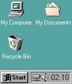
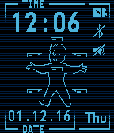
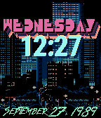

<!-- Generated by scripts/update_app_directory.py: do not edit by hand -->
[← All Pebble Developers](../developers.md)

# Averso

*3 watchfaces · Last updated 2026-10-11 · [About these lists](../about-app-lists.md)*

Links: [Rebble App Store](https://apps.rebble.io/en_US/developer/5812f6ad46041fb22f00005e/1) · [Pebble App Store](https://apps.repebble.com/apps/dev/averso_5812f6ad46041fb22f00005e) · [GitHub (Averso)](https://github.com/Averso)

<button type="button" data-filter="all" aria-pressed="true">All 3</button><button type="button" data-filter="watchface" aria-pressed="false">Watchfaces 3</button><button type="button" data-filter="watchapp" aria-pressed="false" disabled>Apps 0</button>

<label class="dev-sort">Sort by <select><option value="updated">Recently updated</option><option value="released">Newest release</option><option value="title">A–Z</option></select></label>

<h2 class="app-name" id="app-5851d646ce45dcbc7a0000d9"><a href="https://apps.rebble.io/en_US/application/5851d646ce45dcbc7a0000d9">Windows 98</a> v1.6</h2>
<a class="app-source" href="https://github.com/Averso/Windows98Face" title="Source code" data-search-exclude>View source</a>

Watchface

No licence Released 2016-12-14 Updated 2017-01-25 Rebble App Store

Runs on: Time 2, Pebble 2 Duo, Pebble 2, Time, Classic

Go retro with my watchface! Iconic operation system Windows 98 on your Pebble! Icons on taskbar represent bluetooth connection and quiet time. Recycle bin will change to full when battery level…

<h2 class="app-name" id="app-5833903a00355a9f11000228"><a href="https://apps.repebble.com/5833903a00355a9f11000228">Pip-Boy 3000</a> v1.3</h2>
<a class="app-source" href="https://github.com/Averso/PipBoyFace" title="Source code" data-search-exclude>View source</a>

Watchface

No licence Released 2016-11-22 Updated 2017-01-01

Runs on: Round 2, Time 2, Pebble 2 Duo, Pebble 2, Time Round, Time

I made this watchface to get close to Pip-Boy 3000 feeling with having clear view on time and date. Features: - 4 colors variants as in Fallout 3/NV games - 3 Vault Boy images representing battery…

<h2 class="app-name" id="app-581dfc519cbbaf5d820001cb"><a href="https://apps.repebble.com/581dfc519cbbaf5d820001cb">Hotline Miami Face</a> v1.6</h2>
<a class="app-source" href="https://github.com/Averso/HotlineMiamiFace" title="Source code" data-search-exclude>View source</a>

Watchface

No licence Released 2016-11-05 Updated 2017-01-01

Runs on: Round 2, Time 2, Time Round, Time

Watchface based on Hotline Miami logo. Features: - Hiding base image background to set your own color - Two positions of clock - Show/hide date - Two date fonts - Color selector for date Fonts…

