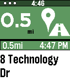

<!-- Generated by scripts/update_app_directory.py: do not edit by hand -->
[← All Pebble Developers](../developers.md)

# aviation\_hacker

*1 app · Last updated 2026-10-12 · [About these lists](../about-app-lists.md)*

Links: [Rebble App Store](https://apps.rebble.io/en_US/developer/5b6faadba423b9000124ad93/1)

<h2 class="app-name" id="app-666e80ff7568f7000a0b966f"><a href="https://apps.rebble.io/en_US/application/666e80ff7568f7000a0b966f">Pebble Nav Me (2026 Edition)</a> v1.58</h2>
<a class="app-source" href="https://www.reddit.com/r/pebble/comments/1vy0g25/pebble_nav_me_v158_2026/" title="Source code" data-search-exclude>View source</a>

App · <a href="https://forum.rebble.io/t/1034" title="Discuss this app on the Rebble forum" data-search-exclude>Forum thread</a>

Released 2024-06-16 Updated 2026-08-25 Rebble App Store

Runs on: Round 2, Time 2, Pebble 2 Duo, Pebble 2, Time Round, Time, Classic

This is an modified version of the Original Pebble Nav Me App made by bates.apps. This version is modified to work with Google Maps Post December 2025, and the listing serves as a means of…

