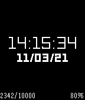
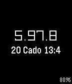

<!-- Generated by scripts/update_app_directory.py: do not edit by hand -->
[← All Pebble Developers](../developers.md)

# Avii

*2 watchfaces · Last updated 2026-10-11 · [About these lists](../about-app-lists.md)*

Links: [Rebble App Store](https://apps.rebble.io/en_US/developer/6048c8181342ae005770a0c3/1) · [GitHub (AviiNL)](https://github.com/AviiNL)

<button type="button" data-filter="all" aria-pressed="true">All 2</button><button type="button" data-filter="watchface" aria-pressed="false">Watchfaces 2</button><button type="button" data-filter="watchapp" aria-pressed="false" disabled>Apps 0</button>

<label class="dev-sort">Sort by <select><option value="updated">Recently updated</option><option value="released">Newest release</option><option value="title">A–Z</option></select></label>

<h2 class="app-name" id="app-604a1fb81342ae0161656655"><a href="https://apps.rebble.io/en_US/application/604a1fb81342ae0161656655">Step Goal</a> v1.0</h2>
<a class="app-source" href="https://github.com/AviiNL/stepgoal" title="Source code" data-search-exclude>View source</a>

Watchface

No licence Released 2021-03-11 Updated 2021-03-16 Rebble App Store

Runs on: Round 2, Time 2, Pebble 2 Duo, Pebble 2, Time Round, Time, Classic

Simple watchface with a step counter and step goal. The watch vibrates as soon as the goal has been reached. The goal is configurable from the pebble phone app.

<h2 class="app-name" id="app-6048c8191342ae005770a0c5"><a href="https://apps.rebble.io/en_US/application/6048c8191342ae005770a0c5">O&#x27;Harean</a> v1.0</h2>
<a class="app-source" href="https://github.com/AviiNL/oharean-watchface" title="Source code" data-search-exclude>View source</a>

Watchface

No licence Released 2021-03-10 Updated 2021-03-10 Rebble App Store

Runs on: Round 2, Time 2, Pebble 2 Duo, Pebble 2, Time Round, Time, Classic

O&#x27;Harean calander based watchface Tap or shake to switch between O&#x27;Harean and Regular clocks. Make sure to select your timezone in the settings.

