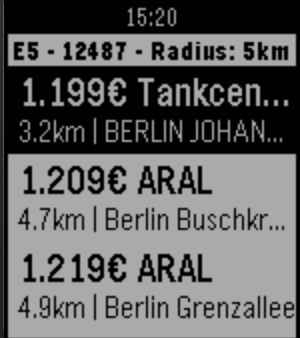

<!-- Generated by scripts/update_app_directory.py: do not edit by hand -->
[← All Pebble Developers](../developers.md)

# awlx

*1 app · Last updated 2026-10-12 · [About these lists](../about-app-lists.md)*

Links: [Pebble App Store](https://apps.repebble.com/apps/dev/awlx_53c8f4109fb0e121280000ed) · [GitHub (awlx)](https://github.com/awlx)

<h2 class="app-name" id="app-56f92d675e4cdd12c9000039"><a href="https://apps.repebble.com/56f92d675e4cdd12c9000039">SpritPreis</a> v1.2</h2>
<a class="app-source" href="https://github.com/awlx/Pebble-SpritPreis" title="Source code" data-search-exclude>View source</a>

App

GPL-3.0 Released 2016-03-28 Updated 2016-03-28

Runs on: Round 2, Time 2, Pebble 2 Duo, Pebble 2, Time Round, Time, Classic

# Pebble-SpritPreis WatchApp um aktuelle Spritpreise auf der Uhr zusehen. Damit man immer die günstigste Tankstelle zum Tanken in der Nähe findet. (Nur Deutschland) App to fetch fuel prices from…

