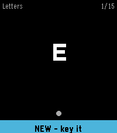
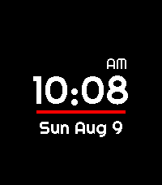

<!-- Generated by scripts/update_app_directory.py: do not edit by hand -->
[← All Pebble Developers](../developers.md)

# awwaiid

*1 watchface and 1 app · Last updated 2026-10-12 · [About these lists](../about-app-lists.md)*

Links: [Pebble App Store](https://apps.repebble.com/apps/dev/awwaiid_a6122c9c814c119e3a27343e) · [GitHub (awwaiid)](https://github.com/awwaiid)

<button type="button" data-filter="all" aria-pressed="true">All 2</button><button type="button" data-filter="watchface" aria-pressed="false">Watchfaces 1</button><button type="button" data-filter="watchapp" aria-pressed="false">Apps 1</button>

<label class="dev-sort">Sort by <select><option value="updated">Recently updated</option><option value="released">Newest release</option><option value="title">A–Z</option></select></label>

<h2 class="app-name" id="app-05be35b816874fa9a85ce6c4"><a href="https://apps.repebble.com/05be35b816874fa9a85ce6c4">Learn Morse</a> v1.0.1</h2>
<a class="app-source" href="https://github.com/awwaiid/pebble-watchapp-learn-morse" title="Source code" data-search-exclude>View source</a>

App

MIT Released 2026-09-12 Updated 2026-09-12

Runs on: Round 2, Time 2, Pebble 2 Duo, Pebble 2, Time Round, Time, Classic

Learn to send Morse code on your wrist. Learn Morse shows you a character and you key it back. A short press of the DOWN button is a dot and a hold is a dash; on Pebble Time 2 you can key on the…

<h2 class="app-name" id="app-b063aceac2394267982a890d"><a href="https://apps.repebble.com/b063aceac2394267982a890d">Basic big digital</a> v1.1.1</h2>
<a class="app-source" href="https://github.com/awwaiid/pebble-watchface-basic-big-digital" title="Source code" data-search-exclude>View source</a>

Watchface

MIT Released 2026-08-09 Updated 2026-08-09

Runs on: Time 2

Big, clean digital watchface for Pebble Time 2 (emery). Huge centered LECO digits, AM/PM tucked above the last digit in 12-hour mode, a red accent line, and a date line you can configure from the…

