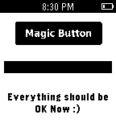

<!-- Generated by scripts/update_app_directory.py: do not edit by hand -->
[← All Pebble Developers](../developers.md)

# aybuke ozdemir

*1 app · Last updated 2026-10-12 · [About these lists](../about-app-lists.md)*

Links: [Pebble App Store](https://apps.repebble.com/apps/dev/aybuke-ozdemir_535e5fec91c4a6f10d0001f6) · [GitHub (pebble-tr)](https://github.com/pebble-tr)

<h2 class="app-name" id="app-542bf2247a4316d5be000051"><a href="https://apps.repebble.com/542bf2247a4316d5be000051">Magic Button</a> v1.4</h2>
<a class="app-source" href="https://github.com/pebble-tr/Magic-Button" title="Source code" data-search-exclude>View source</a>

App

Released 2014-10-01 Updated 2014-11-18

Runs on: Time 2, Pebble 2 Duo, Pebble 2, Time, Classic

A magic button that makes everything OK. Insprired by http://make-everything-ok.com

