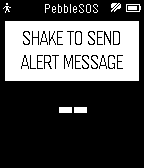

<!-- Generated by scripts/update_app_directory.py: do not edit by hand -->
[← All Pebble Developers](../developers.md)

# AZ

*1 app · Last updated 2026-10-11 · [About these lists](../about-app-lists.md)*

Links: [Pebble App Store](https://apps.repebble.com/apps/dev/az_541cbd8d8de571cb4800001c) · [GitHub (Uberi)](https://github.com/Uberi)

<h2 class="app-name" id="app-5542ef13a7a3a66ee500002a"><a href="https://apps.repebble.com/5542ef13a7a3a66ee500002a">PebbleSOS</a> v1.0</h2>
<a class="app-source" href="https://github.com/Uberi/PebbleSOS" title="Source code" data-search-exclude>View source</a>

App

MIT Released 2015-05-01 Updated 2015-05-01

Runs on: Time 2, Pebble 2 Duo, Pebble 2, Time, Classic

====== IMPORTANT ====== THE COMPANION APP FOR iOS IS CURRENTLY PENDING APPROVAL, AND IS EXPECTED TO RELEASE AROUND MAY 14TH. THE COMPANION APP IS REQUIRED FOR POSTING MESSAGES. ====== IMPORTANT…

