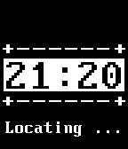

<!-- Generated by scripts/update_app_directory.py: do not edit by hand -->
[← All Pebble Developers](../developers.md)

# AzagraMac

*1 watchface · Last updated 2026-10-11 · [About these lists](../about-app-lists.md)*

Links: [Pebble App Store](https://apps.repebble.com/apps/dev/azagramac_52d139f7139ef133cb00001a) · [GitHub (AzagraMac)](https://github.com/AzagraMac) · [Website (azagra.me)](http://azagra.me)

<h2 class="app-name" id="app-549c77d245afee949800076f"><a href="https://apps.repebble.com/549c77d245afee949800076f">Clock simple</a> v1.0</h2>
<a class="app-source" href="https://github.com/AzagraMac/Pebble_ClockSDK" title="Source code" data-search-exclude>View source</a>

Watchface

No licence Released 2014-12-25 Updated 2014-12-25

Runs on: Time 2, Pebble 2 Duo, Pebble 2, Time, Classic

A simple clock that uses the GPS to find out about the temperature where you are.

