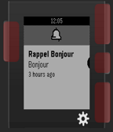

<!-- Generated by scripts/update_app_directory.py: do not edit by hand -->
[← All Pebble Developers](../developers.md)

# AzRun

*2 apps · Last updated 2026-10-11 · [About these lists](../about-app-lists.md)*

Links: [Rebble App Store](https://apps.rebble.io/en_US/developer/592d05870dfc326582000aee/1) · [GitHub (AzzRun)](https://github.com/AzzRun)

<button type="button" data-filter="all" aria-pressed="true">All 2</button><button type="button" data-filter="watchface" aria-pressed="false" disabled>Watchfaces 0</button><button type="button" data-filter="watchapp" aria-pressed="false">Apps 2</button>

<label class="dev-sort">Sort by <select><option value="updated">Recently updated</option><option value="released">Newest release</option><option value="title">A–Z</option></select></label>

<h2 class="app-name" id="app-594cde1eb67f9fae630013ae"><a href="https://apps.rebble.io/en_US/application/594cde1eb67f9fae630013ae">Reminder</a> v1.1-rbl1</h2>
<a class="app-source" href="https://github.com/AzzRun/Pebble-Reminder" title="Source code" data-search-exclude>View source</a>

App

No licence Released 2017-06-23 Updated 2019-07-24 Rebble App Store

Runs on: Round 2, Time 2, Pebble 2 Duo, Pebble 2, Time Round, Time, Classic

<h2 class="app-name" id="app-59774e5f461a8d1889000401"><a href="https://apps.rebble.io/en_US/application/59774e5f461a8d1889000401">Crypto Currency Indicator</a> v1.1</h2>
<a class="app-source" href="https://github.com/AzzRun/Pebble-CoinInfo" title="Source code" data-search-exclude>View source</a>

App

No licence Released 2017-07-25 Updated 2017-08-18 Rebble App Store

Runs on: Round 2, Time 2, Pebble 2 Duo, Pebble 2, Time Round, Time, Classic

A simple currency monitor for Bitcoin,Ethereum and Bitcoin Cash. Un moniteur simple de monnaie pour Bitcoin, Ethereum et Bitcoin Cash.

