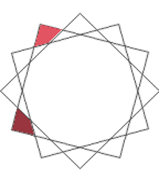
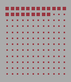

<!-- Generated by scripts/update_app_directory.py: do not edit by hand -->
[← All Pebble Developers](../developers.md)

# b123400

*6 watchfaces · Last updated 2026-10-12 · [About these lists](../about-app-lists.md)*

Links: [Rebble App Store](https://apps.rebble.io/en_US/developer/52f044741ac79491190010f0/1) · [Pebble App Store](https://apps.repebble.com/apps/dev/b123400_52f044741ac79491190010f0) · [GitHub (b123400)](https://github.com/b123400) · [Website (b123400.net)](https://b123400.net)

<button type="button" data-filter="all" aria-pressed="true">All 6</button><button type="button" data-filter="watchface" aria-pressed="false">Watchfaces 6</button><button type="button" data-filter="watchapp" aria-pressed="false" disabled>Apps 0</button>

<label class="dev-sort">Sort by <select><option value="updated">Recently updated</option><option value="released">Newest release</option><option value="title">A–Z</option></select></label>

<h2 class="app-name" id="app-5aeb24c5f38588775f000789"><a href="https://apps.rebble.io/en_US/application/5aeb24c5f38588775f000789">Shapes</a> v1.1.1</h2>
<a class="app-source" href="https://github.com/b123400/shapes" title="Source code" data-search-exclude>View source</a>

Watchface · <a href="https://forum.rebble.io/t/1100" title="Discuss this app on the Rebble forum" data-search-exclude>Forum thread</a>

MIT Released 2018-05-03 Updated 2026-06-28 Rebble App Store

Runs on: Round 2, Time 2, Pebble 2 Duo, Pebble 2, Time Round, Time, Classic

The shape&#x27;s number of line indicate the current minutes divided by 5, and the background lines indicate the hour.

<h2 class="app-name" id="app-682ea4a4956ef60009734fa8"><a href="https://apps.rebble.io/en_US/application/682ea4a4956ef60009734fa8">Sam</a> v1.0.1</h2>
<a class="app-source" href="https://github.com/b123400/sam" title="Source code" data-search-exclude>View source</a>

Watchface · <a href="https://forum.rebble.io/t/1101" title="Discuss this app on the Rebble forum" data-search-exclude>Forum thread</a>

GPL-3.0 Released 2025-05-22 Updated 2026-06-28 Rebble App Store

Runs on: Round 2, Time 2, Pebble 2 Duo, Pebble 2, Time Round, Time, Classic

An abstract watch face. Hours is indicated by the upper shapes, the total number of edge = the current hour. e.g. triangle (3) + square(4) = 7 o&#x27;clock. Minutes is similar and the base unit is 5…

<h2 class="app-name" id="app-5a9c1fb20dfc3214f2000040"><a href="https://apps.rebble.io/en_US/application/5a9c1fb20dfc3214f2000040">Partial</a> v1.2.0</h2>
<a class="app-source" href="https://github.com/b123400/pebble-partial" title="Source code" data-search-exclude>View source</a>

Watchface · <a href="https://forum.rebble.io/t/1098" title="Discuss this app on the Rebble forum" data-search-exclude>Forum thread</a>

GPL-3.0 Released 2018-03-04 Updated 2026-06-28 Rebble App Store

Runs on: Round 2, Time 2, Pebble 2 Duo, Pebble 2, Time Round, Time, Classic

The angle of the half circle indicate the hour. The percentage of the half circle filling up indicate how much time is passed in this hour. Keep in mind that it&#x27;s filling up the area instead of a…

<h2 class="app-name" id="app-58e2bf586ca3871e000004b6"><a href="https://apps.rebble.io/en_US/application/58e2bf586ca3871e000004b6">Circle</a> v1.2.1</h2>
<a class="app-source" href="https://github.com/b123400/circle-watchface" title="Source code" data-search-exclude>View source</a>

Watchface · <a href="https://forum.rebble.io/t/1099" title="Discuss this app on the Rebble forum" data-search-exclude>Forum thread</a>

GPL-3.0 Released 2017-04-03 Updated 2026-06-28 Rebble App Store

Runs on: Round 2, Time 2, Pebble 2 Duo, Pebble 2, Time Round, Time, Classic

Hour and minute are indicated by colour of the nearest block, you can customise the accuracy by the number of vertices, all colours are customisable as well.

<h2 class="app-name" id="app-58237be0b62cefad1500001b"><a href="https://apps.repebble.com/58237be0b62cefad1500001b">1440</a> v1.0</h2>
<a class="app-source" href="https://github.com/b123400/1440-watchface" title="Source code" data-search-exclude>View source</a>

Watchface

GPL-3.0 Released 2016-11-09 Updated 2025-05-22

Runs on: Time 2, Pebble 2 Duo, Pebble 2, Time, Classic

1 grid, 1 day. Every dot represents 10 minutes. This is a watchface inspired by the ttmm series (http://ttmm.eu).

<h2 class="app-name" id="app-56a384f34a212c04ef00003d"><a href="https://apps.repebble.com/56a384f34a212c04ef00003d">Useless</a> v1.0</h2>
<a class="app-source" href="https://github.com/b123400/useless" title="Source code" data-search-exclude>View source</a>

Watchface

GPL-3.0 Released 2016-01-23 Updated 2016-01-23

Runs on: Time 2, Pebble 2 Duo, Pebble 2, Time, Classic

This watchface shows pretty useless texts, but it never tells a lie.

