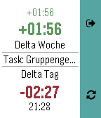

<!-- Generated by scripts/update_app_directory.py: do not edit by hand -->
[← All Pebble Developers](../developers.md)

# BaaaZen (Mirko Hansen)

*1 app · Last updated 2026-10-12 · [About these lists](../about-app-lists.md)*

Links: [Pebble App Store](https://apps.repebble.com/apps/dev/baaazen-mirko-hansen_57767b1c6c2104a3b30005f9) · [GitHub (BaaaZen)](https://github.com/BaaaZen)

<h2 class="app-name" id="app-57ae0288f01b53901a00021c"><a href="https://apps.repebble.com/57ae0288f01b53901a00021c">Time Recording</a> v1.1</h2>
<a class="app-source" href="https://github.com/BaaaZen/TimerecordingForPebble" title="Source code" data-search-exclude>View source</a>

App

MPL-2.0 Released 2016-08-12 Updated 2016-11-08

Runs on: Round 2, Time 2, Pebble 2 Duo, Pebble 2, Time Round, Time, Classic

Timerecording for Pebble is an information and control app for Time Recording on the Pebble Smartwatch. The companion app is compatible with the pro version of Time Recording, as well as with the…

