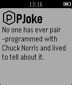

<!-- Generated by scripts/update_app_directory.py: do not edit by hand -->
[← All Pebble Developers](../developers.md)

# Bal1

*1 app · Last updated 2026-10-12 · [About these lists](../about-app-lists.md)*

Links: [Pebble App Store](https://apps.repebble.com/apps/dev/bal1_55094e0f7d3b947fe50000de) · [GitHub (yyaskiv)](https://github.com/yyaskiv)

<h2 class="app-name" id="app-55095e3cc9bc1664e10000e3"><a href="https://apps.repebble.com/55095e3cc9bc1664e10000e3">PJoke</a> v1.0</h2>
<a class="app-source" href="https://github.com/yyaskiv/PJoke" title="Source code" data-search-exclude>View source</a>

App

Released 2015-03-18 Updated 2015-03-18

Runs on: Time 2, Pebble 2 Duo, Pebble 2, Time, Classic

Random joke about Chuck Norris

